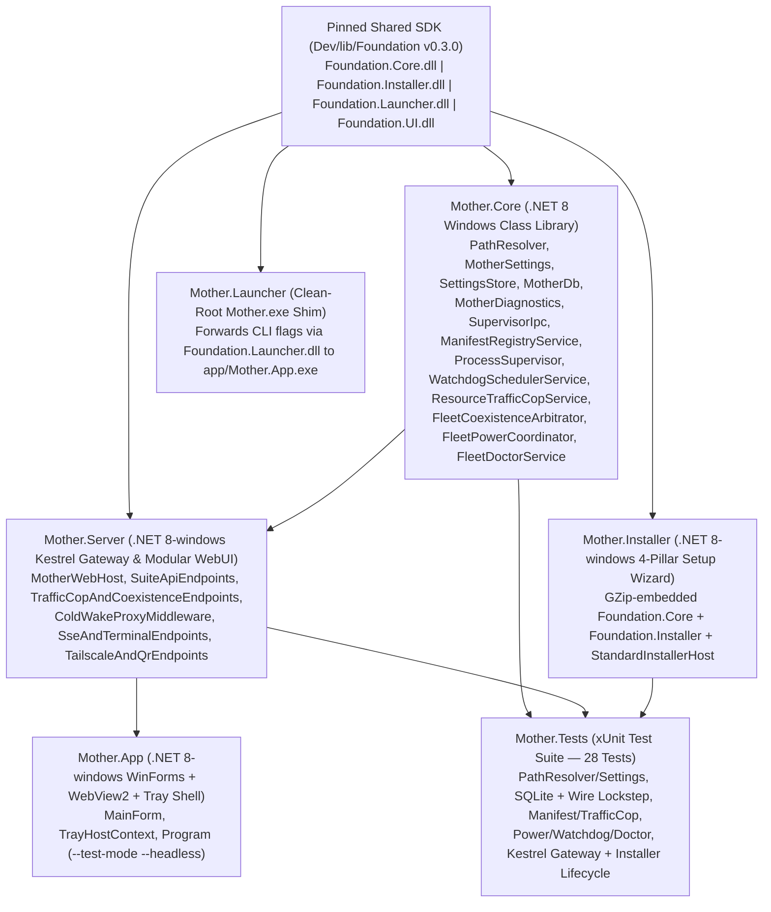

# Mother — Deep Architecture, Fleet Supervision Graph & Symbol Map (`ARCHITECTURE.md`)

> **Active Baseline Version:** `v0.1.0` | **Full SemVer (`MAJOR.MINOR.PATCH`)** | **Owner:** `@devv` & `@pland` | **Clarity Editor:** `@tessa` ("The Manual Maker") | **Verified By:** `@dean` ([Standard 16 §3.5](file:///<WORKSPACE_ROOT>/<DEV_BIBLE>/16_PROJECT_DOSSIERS_AND_FEATURE_TRACKING.md))

This technical manual documents the system context, runtime process topology, assembly dependency graph, end-to-end orchestration pipelines, file and symbol lookup registry, persistence stores, failure-mode engineering, security model, testing strategy, architectural decision records (ADRs), and zero-touch extension playbooks for **`Mother`** ([`<WORKSPACE_ROOT>/Mother\`](file:///<WORKSPACE_ROOT>/Mother/)), the Single Shared Suite Daemon (`:5100`), unified system tray sentinel, reverse-proxy API gateway, schedule traffic cop, post-run power coordinator, and cross-app coexistence broker for the 6 sister applications (**Housekeeping** `:5178`, **ShadowLibrary** `:5179`, **Redroom** `:5180`, **Greenroom** `:8420`, **StreamEngine** `:8430`, and **legacy-sister-app** `:8460`).

---

## 1. System Context & Runtime Model

> [!IMPORTANT]
> **Single Shared Suite Daemon & Single Public Gateway ([Standard 08 §4–§6](file:///<WORKSPACE_ROOT>/<DEV_BIBLE>/08_APPLICATION_ARCHETYPES_AND_LIFECYCLE.md), [Standard 17 §1, §4, §5](file:///<WORKSPACE_ROOT>/<DEV_BIBLE>/17_SISTER_COMPATIBILITY_AND_FEATURE_PARITY.md))**
> `Mother` eliminates competing system tray icons, duplicate Task Scheduler watchdogs, and uncoordinated 3:00 AM disk thrashing across the workstation. Only `Mother` binds a public/LAN/Tailscale gateway port (`http://127.0.0.1:5100/`, Tailscale HTTPS `:8500`, Sandbox `:15100`). All 6 sister applications run as supervised child workers bound strictly to `127.0.0.1` loopback (`:5178..5180`, `:8420..8460`) with `--managed-by-mother` / `--managed-by-suite`, managed according to their per-app residency mode (`Warm`, `Cold`, or `Disabled`).

### Runtime Process, Threading & Residency Model
1. **Single-Instance & Supervisor Mutexes ([`v0.1.0.2026-11-12.md`](file:///<WORKSPACE_ROOT>/Mother/Dev/docs/plans/v0.1.0.2026-11-12.md)):** On startup, `Mother` acquires `Global\Mother_SingleInstance_Mutex` and `Global\Mother_Supervisor_Active` (via `SupervisorIpc`, isolated with `Mother_Sandbox_` prefix under `--test-mode`). Child sister apps inspect `Global\Mother_Supervisor_Active` (and `--managed-by-mother`) to suppress their standalone system tray icons.
2. **Per-App Residency Loop (`Warm`, `Cold`, `Disabled` — [Standard 17 §4.2](file:///<WORKSPACE_ROOT>/<DEV_BIBLE>/17_SISTER_COMPATIBILITY_AND_FEATURE_PARITY.md#L213-L222)):**
   - **`Warm`:** Spawned at `Mother` boot (`--managed-by-mother --bind 127.0.0.1 --port <internalPort>`); health-polled every `250ms` during startup and `5000ms` default steady-state (`HealthPollerService`).
   - **`Cold` (`0 MB` RAM when idle):** Not spawned at boot. Automatically woken on UI navigation (`/app/<app-id>/`), API call (`/api/v1/apps/<app-id>/*`), or due schedule in `schedules[]` (`ColdWakeCoordinator`), and gracefully hibernated after `idleTimeoutMinutes` (`15m` default) once `activeJobs == 0` and `queuedJobs == 0`.
   - **`Disabled`:** Registered in `manifests\`, but skipped by boot, schedules, and background polling until enabled by the user.
3. **WebView2 Isolated Shell & Tab Strip (`Alt+1..7`):** `MainForm` hosts the Single-Window WebView2 shell (`DataDirectory\webview2` isolated user-data directory) with `AppDiscovery`/tab virtualization across `Mother` and all 6 sister applications.

---

## 2. Project & Module Dependency Graph

Per [`Dev\docs\plans\v0.1.0.2026-11-12.md`](file:///<WORKSPACE_ROOT>/Mother/Dev/docs/plans/v0.1.0.2026-11-12.md) and [`README.md#L33-L37`](file:///<WORKSPACE_ROOT>/Mother/README.md#L33-L37), `Mother` pins **`Foundation v0.3.0`** (`Foundation.Core.dll`, `Foundation.Installer.dll`, `Foundation.Launcher.dll`, `Foundation.UI.dll`, plus `wwwroot\vendor\foundation\`) from [`<WORKSPACE_ROOT>/SharedLibs\Foundation\v0.3.0\`](file:///<WORKSPACE_ROOT>/SharedLibs/Foundation/v0.3.0/) into `Dev\lib\` and separates its solution (`Dev\Mother.slnx`) into 6 focused projects:

| Project / Assembly | Target Framework | Allowed References | Forbidden References |
| :--- | :--- | :--- | :--- |
| **`Mother.Core`** | `net8.0-windows` | `Foundation.Core.dll`, BCL, `Microsoft.Data.Sqlite`, `System.Security.Cryptography.ProtectedData` | Zero WinForms/WebView2 UI dependencies; zero hardcoded host paths; zero direct sister-app repo references. |
| **`Mother.Server`** | `net8.0-windows` | `Mother.Core`, `Foundation.Core.dll`, `Microsoft.AspNetCore.App` | Zero direct mutations inside child sister-app `data\` databases (HTTP proxy + `.coexistence.json` only). |
| **`Mother.App`** | `net8.0-windows` | `Mother.Core`, `Mother.Server`, `Foundation.Core.dll`, `Microsoft.Web.WebView2` | Zero direct WinForms dependencies in `Mother.Core`. |
| **`Mother.Launcher`** | `net8.0-windows` | `Foundation.Launcher.dll` (embedded) | Zero heavy server/WinForms/SQLite libraries at clean root (`Mother.exe`). |
| **`Mother.Installer`** | `net8.0-windows` | `Foundation.Core.dll.gz`, `Foundation.Installer.dll.gz` (GZip-embedded via `AssemblyResolve`) | Zero Inno Setup (`installer.iss`), third-party MSI, or hardcoded PII/host paths (`FindingCount: 0`). |
| **`Mother.Tests`** | `net8.0-windows` | `Mother.Core`, `Mother.Server`, `Mother.Installer`, `Foundation.*`, `Microsoft.AspNetCore.TestHost`, `xUnit` | Zero uncontained `<PROGRAMS_ROOT>/...` access during test execution. |

---

## 3. End-to-End Data Flow per Pipeline

### Pipeline A: Dual-Schema Manifest Discovery & Residency Supervision (`ManifestRegistryService` $\rightarrow$ `ProcessSupervisor`)
1. **Directory Scan ([`v0.1.0.2026-11-12.md`](file:///<WORKSPACE_ROOT>/Mother/Dev/docs/plans/v0.1.0.2026-11-12.md)):** `ManifestRegistryService` scans `DataDirectory\manifests\*.json` (`*.manifest.json`) as well as `--programs-dir` (`*\app\suite.manifest.json` and `*\mother.manifest.json`, or `Sandbox\data\manifests\` + `Sandbox\data\mock-apps\` in `--test-mode`).
2. **Dual-Schema Normalization ([`1715` Report §5.1](file:///<WORKSPACE_ROOT>/Mother/Dev/docs/reports/archive/v0.1.0-alpha.1.2026-11-03_1715.-.fleet-coexistence-broker-and-manifest-schema.md#L59-L60)):** To guarantee zero discovery failures across upgraded and pre-upgrade sister apps, `ManifestRegistryService` normalizes both Standard 17 `v2` `camelCase` keys (`schemaVersion: 2`, `appId`, `name`, `brandAccent`, `minSuiteVersion`, `sdkVersion`, `internalPort`, `endpoints.*`) and legacy `v1` `snake_case` keys (`schema_version`, `app_id`, `display_name`, `brand_accent` / `brand_color`, `health_endpoint`).
3. **Child Process Launch & Health Polling:** For each app whose residency is `warm` (or when a `cold` app is woken via `ColdWakeCoordinator`), `ProcessSupervisor` spawns the child process with `--managed-by-mother --bind 127.0.0.1 --port <internalPort>`, polls `/api/v1/health` (`HealthPollerService`) every `250ms` during startup so WebView2 never hits `ERR_CONNECTION_REFUSED`, and transitions to `5000ms` steady-state polling with a `3 crashes in 60s` circuit-breaker latch.

### Pipeline B: Fleet Schedule Traffic Cop & `.hklock` Drive Contention Arbitration (`ResourceTrafficCopService`)
1. **Schedule & Sentinel Poll ([`1715` Report §5.3](file:///<WORKSPACE_ROOT>/Mother/Dev/docs/reports/archive/v0.1.0-alpha.1.2026-11-03_1715.-.fleet-coexistence-broker-and-manifest-schema.md#L65-L66)):** `ResourceTrafficCopService` polls active sister apps and `HkLockScanner` inspects `.<app>_<pid>.hklock` sentinels via `Foundation.Core.PidSafeLockfile.IsLockedByLiveProcess` on registered `targetDrives` / `sharedMounts`.
2. **Drive Mutex Contention Detection:** If App A (e.g. `ShadowLibrary` bit-rot scrub) holds a live `.hklock` on a shared mount/drive and App B has a colliding job, `ResourceTrafficCopService` detects the contention and classifies dead-PID locks as `stale`.
3. **Automatic Schedule Deferral:** Dispatches `POST /api/v1/scheduler/defer` (simulated/persisted in `--test-mode`), logs the deferral into `schedule_deferrals` (`mother.db`), and emits an SSE `lock_changed` event.

### Pipeline C: 4-Pillar Fleet Coexistence Broker (`FleetCoexistenceArbitrator`)
1. **Online & Offline Coexistence Aggregation ([`FEATURES.md#L27-L34`](file:///<WORKSPACE_ROOT>/Mother/FEATURES.md#L27-L34)):** `FleetCoexistenceArbitrator` aggregates status across registered apps and `<SharedRoot>\.coexistence.json` manifests when a `Cold` peer is hibernating, while `SecretVaultInspector` surfaces DPAPI key metadata (`keyName`, `valueByteLength`, `updatedAtUtc`) without decrypting plaintext.
2. **Conflict Matrix & 1-Click Auto-Align:** Exposes `GET /api/v1/suite/coexistence/status`. When the user clicks **`Apply Safe-Stagger`** / **`Align Fleet Settings`** (`POST /api/v1/suite/coexistence/apply-recommendations`), `Mother` applies non-conflicting presets and updates `<SharedRoot>\.coexistence.json`.

### Pipeline D: Fleet-Wide Post-Run Power Coordinator (`FleetPowerCoordinator`)
1. **Aggregate Queue Monitoring ([`0532` Pillar 4](file:///<WORKSPACE_ROOT>/Mother/Dev/docs/reports/archive/v0.1.0-alpha.1.2026-11-02_0532.-.sister-app-feature-parity.md#L53)):** Individual sister apps never invoke OS `Sleep` or `Shutdown` directly. Instead, `FleetPowerCoordinator` monitors `activeJobs` and `queuedJobs` across all registered sister apps and coordinates `PowerSleepInhibitor` (`SetThreadExecutionState`).
2. **60-Second Cancellable Countdown:** When set to `Sleep` or `Shutdown` and aggregate `activeJobs + queuedJobs == 0` with `0` live `.hklock` holds, `FleetPowerCoordinator` starts a 60-second cancellable countdown (`power_countdown` SSE ticks; OS sleep/shutdown syscalls are hard-disabled/simulated in `--test-mode`).

---

## 4. Complete File & Symbol Lookup Registry (`<= 400 LOC` Hard Gate)

### 4.1 Current On-Disk Dossiers, Blueprints & Archived Reports (`v0.1.0` Baseline)

| File Path (Relative to `<WORKSPACE_ROOT>/Mother\`) | Exact LOC | `<= 400 LOC` Status | Primary Symbols / Sections | Role & Responsibility |
| :--- | :---: | :---: | :--- | :--- |
| [`active.state`](file:///<WORKSPACE_ROOT>/Mother/active.state#L1-L13) | `13` | ✅ `PASS` | `state: "active"`, `version: "0.1.0"` | Canonical Tier A lifecycle state marker. |
| [`README.md`](file:///<WORKSPACE_ROOT>/Mother/README.md#L1-L53) | `53` | ✅ `PASS` | Root Quartet #1 | Quickstart, `:5100` gateway overview, `Foundation v0.3.0` pin, and manual links. |
| [`FEATURES.md`](file:///<WORKSPACE_ROOT>/Mother/FEATURES.md#L1-L34) | `34` | ✅ `PASS` | Root Quartet #2 | Feature index and 6-sister-app Cross-App Operability & Conflict Matrix (`:5178..8460`). |
| [`ROADMAP.md`](file:///<WORKSPACE_ROOT>/Mother/ROADMAP.md#L1-L31) | `31` | ✅ `PASS` | Root Quartet #3 | North Star goal, `v0.1.0` -> `v0.2.0` -> `v1.0.0` trajectory, and milestone checklist. |
| [`CHANGELOG.md`](file:///<WORKSPACE_ROOT>/Mother/CHANGELOG.md#L1-L28) | `28` | ✅ `PASS` | Root Quartet #4 | Keep a Changelog version history (`v0.1.0`). |
| [`Dev/docs/plans/v0.1.0.2026-11-12.md`](file:///<WORKSPACE_ROOT>/Mother/Dev/docs/plans/v0.1.0.2026-11-12.md#L1-L396) | `396` | ✅ `PASS` | `@pland` Master Blueprint (`@dean PASS`) | Locked `v0.1.0` architecture and `T1`–`T11` implementation checklist. |
| [`Dev/docs/reports/archive/v0.1.0-alpha.1.2026-11-02_0448.-.scaffold-and-readiness-audit.md`](file:///<WORKSPACE_ROOT>/Mother/Dev/docs/reports/archive/v0.1.0-alpha.1.2026-11-02_0448.-.scaffold-and-readiness-audit.md#L1-L181) | `181` | ✅ `PASS` | `@inspecter` Audit Report (`0448`) | Initial 6-folder scaffold, crash-bundle, clean-root, and installer compliance audit. |
| [`Dev/docs/reports/archive/v0.1.0-alpha.1.2026-11-02_0532.-.sister-app-feature-parity.md`](file:///<WORKSPACE_ROOT>/Mother/Dev/docs/reports/archive/v0.1.0-alpha.1.2026-11-02_0532.-.sister-app-feature-parity.md#L1-L73) | `73` | ✅ `PASS` | `@inspecter` Parity Report (`0532`) | 12 locked-in fleet parity pillars (Power Coordinator, `\Mother_Watchdog`, Traffic Cop, Orthogonal Tabs). |
| [`Dev/docs/reports/archive/v0.1.0-alpha.1.2026-11-03_1715.-.fleet-coexistence-broker-and-manifest-schema.md`](file:///<WORKSPACE_ROOT>/Mother/Dev/docs/reports/archive/v0.1.0-alpha.1.2026-11-03_1715.-.fleet-coexistence-broker-and-manifest-schema.md#L1-L72) | `72` | ✅ `PASS` | `@inspecter` Coexistence Report (`1715`) | Dual-schema `camelCase`/`snake_case` manifest loader, `FleetCoexistenceArbitrator`, and `.hklock` Traffic Cop. |

### 4.2 Implemented C# / Web / Installer Slices in `Dev\` (`<= 400 LOC` Hard Gate Verified)

| Slice Path (Relative to `Dev\`) | Exact LOC | `<= 400 LOC` Gate | Primary Exported Symbols | Role & Responsibility |
| :--- | :---: | :---: | :--- | :--- |
| `migrations/0001_initial_schema.sql` | `64` | ✅ `PASS` | `fleet_health_events`, `schedule_deferrals`, `notification_history` | Standard 18 §3 SQLite schema (`PRAGMA user_version = 1`). |
| `Mother.Core/Core/MotherRuntime.cs` | `181` | ✅ `PASS` | `MotherRuntime`, `SuiteRuntimeOptions` | Central orchestrator wiring configuration, DB, supervisor, traffic cop, power, and doctor. |
| `Mother.Core/Core/Configuration/{PathResolver,MotherSettings,SettingsStore}.cs` | `210` / `100` / `121` | ✅ `PASS` | `PathResolver`, `MotherSettings`, `SettingsStore` | Dynamic drive-agnostic paths + 20-snapshot atomic settings store. |
| `Mother.Core/Core/Persistence/{MotherDb,MotherDbModels}.cs` | `329` / `152` | ✅ `PASS` | `MotherDb`, `FleetHealthEventRow`, `ScheduleDeferralRow`, `NotificationHistoryRow` | `Foundation.Core.SqliteWalPool` (`WAL`, `busyTimeoutMs: 15000`, `PRAGMA user_version`). |
| `Mother.Core/Core/{Diagnostics/MotherDiagnostics,Ipc/SupervisorIpc,Contracts/FleetContracts}.cs` | `128` / `133` / `181` | ✅ `PASS` | `MotherDiagnostics`, `SupervisorIpc`, `SuiteHealthDto`, `FleetConflictDto` | Zero-PII crash bundles, rolling logs, single-instance/supervisor mutexes, wire DTOs. |
| `Mother.Core/Features/Discovery/{ManifestModels,ManifestRegistryService}.cs` | `176` / `164` | ✅ `PASS` | `ManifestRegistryService`, `SuiteAppManifest` | Dual-schema `v2` (`suite.manifest.json`) & `v1` (`mother.manifest.json`) loader. |
| `Mother.Core/Features/Supervision/{ProcessSupervisor,ColdWakeCoordinator,HealthPollerService,WatchdogSchedulerService}.cs` | `318` / `80` / `106` / `109` | ✅ `PASS` | `ProcessSupervisor`, `ColdWakeCoordinator`, `HealthPollerService`, `WatchdogSchedulerService` | `Warm`/`Cold`/`Disabled` residency, 250ms/5000ms polling, 3x/60s latch, `\Mother_Watchdog`. |
| `Mother.Core/Features/TrafficCop/{HkLockScanner,ResourceTrafficCopService}.cs` | `158` / `137` | ✅ `PASS` | `HkLockScanner`, `ResourceTrafficCopService` | PID-safe `.hklock` inspection (`acquiredAtUtc` + `createdAtUtc` fallback), stale purge, schedule deferrals. |
| `Mother.Core/Features/Coexistence/{FleetCoexistenceArbitrator,SecretVaultInspector}.cs` | `219` / `84` | ✅ `PASS` | `FleetCoexistenceArbitrator`, `SecretVaultInspector` | Conflict arbitration, `.coexistence.json` recommendations, key-metadata-only DPAPI inspection. |
| `Mother.Core/Features/Power/{FleetPowerCoordinator,PowerSleepInhibitor}.cs` | `225` / `49` | ✅ `PASS` | `FleetPowerCoordinator`, `PowerSleepInhibitor` | `StayAwake`/`Sleep`/`Shutdown` 60s countdown + `SetThreadExecutionState` inhibitor. |
| `Mother.Core/Features/{Doctor/FleetDoctorService,Notifications/NotificationDispatcher}.cs` | `152` / `65` | ✅ `PASS` | `FleetDoctorService`, `NotificationDispatcher` | System doctor checks, SQLite `.backup`, diagnostic `.zip` export, alerts. |
| `Mother.Server/{Program,MotherWebHost}.cs` & `Endpoints/*.cs` (5 files) | `28`–`248` | ✅ `PASS` | `MotherWebHost`, `SuiteApiEndpoints`, `TrafficCopAndCoexistenceEndpoints`, `ColdWakeProxyMiddleware`, `SseAndTerminalEndpoints`, `TailscaleAndQrEndpoints` | Kestrel gateway (`:5100`/`:15100`), Tailscale CIDR filter, Cold-Wake proxy, SSE, SVG QR, PWA. |
| `Mother.Server/wwwroot/{index.html,css/*,js/*}` (10 custom files) | `44`–`342` | ✅ `PASS` | `mother.css` (`342`), `mother-components.css` (`231`), `app.js` (`265`), `contracts.js`, `sortable-table.js`, `views/*` | Titanium Sky `#38bdf8` shell, `Alt+1..7` tabs, `Ctrl+B` sidebar, mobile nav (`<= 820px` + landscape `<= 900x480`), `Ctrl+\`` drawer, `Ctrl+K`/`?` `<dialog>`. |
| `Mother.App/{Program,MainForm,TrayHostContext}.cs` | `91` / `106` / `175` | ✅ `PASS` | `MainForm`, `TrayHostContext` | WinForms + WebView2 host, `--test-mode --headless`, `TaskbarCreated` sentinel. |
| `Mother.Launcher/Program.cs` & `Mother.Installer/Program.cs` | `38` / `62` | ✅ `PASS` | `Mother.Launcher.Program`, `Mother.Installer.Program` | Clean-root `Mother.exe` launcher + GZip-embedded 4-pillar `StandardInstallerHost` wizard. |
| `Mother.Tests/*.cs` (6 test files + `TempWorkspaceScope.cs`) | `89`–`222` | ✅ `PASS` | `DtoWireKeyLockstep`, `InstallerLifecycle` + 26 tests | 28 xUnit tests passing 100% under Release `/warnaserror` (14 DTOs locked 1:1). |

---

## 5. Persistence Stores, SQLite Tables & Settings Ownership

Per [Standard 17 §4.1](file:///<WORKSPACE_ROOT>/<DEV_BIBLE>/17_SISTER_COMPATIBILITY_AND_FEATURE_PARITY.md#L178-L188), [Standard 18](file:///<WORKSPACE_ROOT>/<DEV_BIBLE>/18_DATA_DICTIONARY_AND_SCHEMA_LOOKUP.md), and [Standard 19](file:///<WORKSPACE_ROOT>/<DEV_BIBLE>/19_SETTINGS_MANIFESTS_LOCKS_AND_NETWORK_SAFETY.md), `Mother` owns the following suite-level persistence files under `<Drive>:\Programs\Mother\` (resolved dynamically via `PathResolver`, or `Sandbox\data\` in `--test-mode`):

| Store / File Path | Format & Pragma / Encoding | Owning `Mother` Slice | Stored Fields & Responsibility |
| :--- | :--- | :--- | :--- |
| **`manifests\*.json`** | UTF-8 No-BOM `camelCase` (`schemaVersion: 2`) or `snake_case` (`v1`) | `ManifestRegistryService` | Dynamic registry of installed sister apps (`housekeeping`, `shadowlibrary`, `redroom`, `greenroom`, `streamengine`, `legacy-sister-app`). |
| **`data\settings.json`** | Atomic `.tmp` $\rightarrow$ `.bak` JSON via `SettingsStore` | `Mother.Core.Configuration` | Stores `schemaVersion` (`1`), `port` (`5100` / `15100`), `useGlobalFormatRules`, `postRunPowerPolicy` (`"StayAwake" \| "Sleep" \| "Shutdown"`), `autoAlignSisterAppSchedules`, and `residencyOverrides`. |
| **`data\config_history\settings_*.json`** | 20-Snapshot JSON Ring Buffer | `SettingsStore` | Supports `Ctrl+S` 1-click config rollback across the 20 most recent suite configuration saves. |
| **`data\secrets.dpapi`** | Windows DPAPI (`CurrentUser`) via `DpapiSecretStore` | `SecretVaultInspector` | Stores encrypted `discord_webhook_url` and gateway tokens at rest; inspector reads key names & byte lengths only. |
| **`data\mother.db`** | SQLite `WAL` (`busyTimeoutMs=15000`, `PRAGMA user_version=1`) | `MotherDb` (`SqliteWalPool`) | Schema in `Dev\migrations\0001_initial_schema.sql`: `fleet_health_events`, `schedule_deferrals`, and `notification_history`. |
| **`<SharedRoot>\.coexistence.json`** | UTF-8 No-BOM `camelCase` JSON | `FleetCoexistenceArbitrator` | Offline shared-root manifest recording which sister apps manage a shared vault/media root and active parity presets. |
| **`logs\mother_*.log` & `logs\crashes\crash_*.json`** | Rotating UTF-8 Logs + Zero-PII JSON Crash Bundles | `MotherDiagnostics` (`CrashBundleService`) | ISO-8601 structured daemon logs and sanitized 50-line ring-buffer crash bundles. |

---

## 6. Failure Modes, Concurrency & Resilience Engineering

| Failure Mode / Contention Scenario | Detection Mechanism in `Mother` | Automated Recovery & Arbitration Path | Spec / Blueprint Reference |
| :--- | :--- | :--- | :--- |
| **Child Sister Daemon Crashes or Hangs** | `ProcessSupervisor` polls child `healthEndpoint` (`/api/v1/health`) via `HealthPollerService` and monitors `Process.Exited`. | Automatically restarts the child worker with `--managed-by-mother`. If a child crashes **3 times within 60 seconds**, `ProcessSupervisor` trips the **Crash-Loop Circuit Breaker**, marks the app tab `ERROR`, writes a fleet alert, and halts restart loops. | [`v0.1.0.2026-11-12.md`](file:///<WORKSPACE_ROOT>/Mother/Dev/docs/plans/v0.1.0.2026-11-12.md) |
| **WebView2 `ERR_CONNECTION_REFUSED` on Cold-Start or Boot** | User clicks a `Cold` or starting app tab before child finishes binding `127.0.0.1:<internalPort>`. | `ColdWakeCoordinator` polls `/api/v1/health` at a fast `250ms` interval during child startup (`8000ms` budget) before `ColdWakeProxyMiddleware` forwards traffic. | [`v0.1.0.2026-11-12.md`](file:///<WORKSPACE_ROOT>/Mother/Dev/docs/plans/v0.1.0.2026-11-12.md), [`Std 17 §4.2`](file:///<WORKSPACE_ROOT>/<DEV_BIBLE>/17_SISTER_COMPATIBILITY_AND_FEATURE_PARITY.md#L220) |
| **Two Sister Apps Schedule Heavy Disk Jobs on the Same Drive at 3:00 AM** | `ResourceTrafficCopService` + `HkLockScanner` detects overlapping `targetDrives` or live `.<app>_<pid>.hklock` sentinels via `PidSafeLockfile`. | Issues/records deferral (`30m` default) in `schedule_deferrals` so the primary job completes with full disk I/O bandwidth. | [`v0.1.0.2026-11-12.md`](file:///<WORKSPACE_ROOT>/Mother/Dev/docs/plans/v0.1.0.2026-11-12.md), [`1715` Report §1.3](file:///<WORKSPACE_ROOT>/Mother/Dev/docs/reports/archive/v0.1.0-alpha.1.2026-11-03_1715.-.fleet-coexistence-broker-and-manifest-schema.md#L24-L25) |
| **Premature OS Sleep/Shutdown While Another Sister App Is Busy** | `FleetPowerCoordinator` checks aggregate `activeJobs + queuedJobs` and live `.hklock` count across all registered apps. | Blocks OS Sleep/Shutdown until aggregate active/queued jobs and live locks reach `0`, then starts a **60-second cancellable countdown**. | [`v0.1.0.2026-11-12.md`](file:///<WORKSPACE_ROOT>/Mother/Dev/docs/plans/v0.1.0.2026-11-12.md), [`0532` Pillar 4](file:///<WORKSPACE_ROOT>/Mother/Dev/docs/reports/archive/v0.1.0-alpha.1.2026-11-02_0532.-.sister-app-feature-parity.md#L17) |
| **Heterogeneous `camelCase` vs `snake_case` Manifests During Fleet Rollout** | `ManifestRegistryService` encounters legacy `v1` `mother.manifest.json` (`app_id`, `brand_color`, `endpoints.health`) alongside `v2` `suite.manifest.json` (`appId`, `brandAccent`). | Dual-schema tolerant parser maps both `camelCase` and `snake_case` properties seamlessly and falls back to canonical `/api/v1/*` routes on `internalPort`. | [`1715` Report §5.1](file:///<WORKSPACE_ROOT>/Mother/Dev/docs/reports/archive/v0.1.0-alpha.1.2026-11-03_1715.-.fleet-coexistence-broker-and-manifest-schema.md#L59-L60) |
| **Windows Explorer (`explorer.exe`) Restart Hides System Tray Icon** | `TrayHostContext` listens for registered Win32 window message `RegisterWindowMessage("TaskbarCreated")`. | Automatically re-registers Mother's single system tray icon (`Global\Mother_Supervisor_Active`) whenever Explorer restarts. | [`Std 17 §3.2 (SIS-10)`](file:///<WORKSPACE_ROOT>/<DEV_BIBLE>/17_SISTER_COMPATIBILITY_AND_FEATURE_PARITY.md#L116) |

---

## 7. Security & Privacy Model

1. **Single Public Gateway & Loopback-Only Child Isolation ([Standard 17 §1.1](file:///<WORKSPACE_ROOT>/<DEV_BIBLE>/17_SISTER_COMPATIBILITY_AND_FEATURE_PARITY.md#L11-L16)):**
   - Only `Mother` binds `:5100` (with optional Tailscale CGNAT `100.64.0.0/10` CIDR filtering via `TailscaleAndQrEndpoints` when `allowTailscaleBind` is enabled). All supervised child sister workers bind strictly to `127.0.0.1` (`:5178..5180`, `:8420..8460`).
2. **DPAPI Webhook & Secret Encryption:**
   - Outbound Discord webhook URLs and gateway credentials are encrypted via `Foundation.Core.DpapiSecretStore` (`data\secrets.dpapi`, `DataProtectionScope.CurrentUser`).
3. **Fail-Closed `--test-mode` Sandbox Isolation ([Standard 02](file:///<WORKSPACE_ROOT>/<DEV_BIBLE>/02_SANDBOXING_AND_TESTING.md)):**
   - Running `Mother.exe --test-mode --data-dir .\data --log-dir .\logs --port 15100` isolates all manifest discovery, SQLite storage, and supervision strictly inside `<WORKSPACE_ROOT>/Mother\Sandbox\`. OS Sleep/Shutdown and `\Mother_Watchdog` Task Scheduler mutations are hard-disabled in `--test-mode` and `--dry-run`.
4. **4-Pillar Zero-PII Signed Installer ([Standard 03 §5](file:///<WORKSPACE_ROOT>/<DEV_BIBLE>/03_VERSIONING_AND_RELEASES.md)):**
   - `Mother-Setup-v0.1.0-win-x64.exe` is compiled with `DebugType=none`, `PathMap`, Authenticode code-signing, GZip-embedded Foundation assemblies, and zero developer path or secret leaks.

---

## 8. Testing Strategy Map

| Verification Layer | Target Components Covered | Key Assertions & Acceptance Criteria | Execution Command |
| :--- | :--- | :--- | :--- |
| **xUnit Unit & Integration Suite (`Mother.Tests`)** | `PathResolver`, `SettingsStore`, `MotherDb`, `DtoWireKeyLockstep`, `ManifestRegistryService`, `ResourceTrafficCopService`, `FleetCoexistenceArbitrator`, `FleetPowerCoordinator`, `MotherWebHost`, `Mother.Installer` | 28 tests passing 100% under Release `/warnaserror`: dual-schema `v1`/`v2` parsing, `.hklock` `acquiredAtUtc`/deferrals, `.coexistence.json` recommendations, `PRAGMA user_version=1`, 14-DTO wire key lockstep, Kestrel + Cold-Wake proxy, silent installer lifecycle (`--test-mode --install-dir`), and heartbeat tag normalization. | `dotnet test "<WORKSPACE_ROOT>/Mother\Dev\Mother.slnx" -c Release` |
| **Headless Sandbox Self-Test (`--test-mode --headless`)** | Full `Mother.exe` Clean-Root Launcher, IPC Mutex, Mock Discovery, SQLite Migration & Doctor | Acquires sandbox mutex, discovers 6 mock sister manifests in `Sandbox\data\manifests`, runs `FleetDoctorService`, and exits deterministically with code `0`. | `<WORKSPACE_ROOT>/Mother\Sandbox\app\Mother.exe --test-mode --headless --data-dir "<WORKSPACE_ROOT>/Mother\Sandbox\data" --log-dir "<WORKSPACE_ROOT>/Mother\Sandbox\logs"` |
| **Live Sandbox Dual-Viewport CDP & DOM Geometry Verification** | Outer Tab Strip (`Alt+1..7`), Sidebar (`Ctrl+B`), Mobile Nav (`<= 820px`), `Ctrl+\`` Terminal, `Ctrl+K` `<dialog>` | Captures live CDP screenshots + `getBoundingClientRect` DOM geometry across `1920x1080`, `390x844`, and `844x390` (`0px` overflow, `0` console/page/HTTP errors). | Live CDP verification into `Sandbox\logs\screenshots\` per [Standard 02 §6.4](file:///<WORKSPACE_ROOT>/<DEV_BIBLE>/02_SANDBOXING_AND_TESTING.md). |
| **4-Pillar Installer Audit (`audit_installer.ps1`)** | `Mother-Setup-v0.1.0-win-x64.exe` (`Installers\` & `<WORKSPACE_ROOT>/Installers\`) | Verifies single-file `.exe`, Authenticode signature, `--test-mode` install/verify/upgrade/uninstall lifecycle, Clean Release Root, and `FindingCount: 0` PII scan. | `powershell -ExecutionPolicy Bypass -File "%USERPROFILE%\.gemini\config\skills\dev\scripts\audit_installer.ps1" -InstallerPath "<WORKSPACE_ROOT>/Mother\Installers" -ExpectedVersion "0.1.0"` |

---

## 9. ADR Design Decisions Log

| ADR ID | Date | Version | Context & Problem | Decision Made | Consequences & Trade-Offs |
| :--- | :---: | :---: | :--- | :--- | :--- |
| **`ADR-001`** | `2026-11-02` | `v0.1.0` | All 6 sister apps standardize on a collapsible **Left Vertical Sidebar Rail (`220px`/`56px`) + `48px` Slim Topbar**. Putting a second vertical sidebar or second inner horizontal tab strip in `Mother` would create visual collision and waste vertical screen real estate. | Assign `Mother` the **Top Horizontal Axis** (`Alt+1..7` outer app tab strip with Titanium Sky `#38bdf8` accent + global fleet controls), while each child app (and `🏛️ Fleet Overview` itself) owns the **Left Vertical Axis** ([`0532` Pillar 7](file:///<WORKSPACE_ROOT>/Mother/Dev/docs/reports/archive/v0.1.0-alpha.1.2026-11-02_0532.-.sister-app-feature-parity.md#L20)). | Orthogonal 2-axis navigation with zero double-sidebar or double-topbar clutter. |
| **`ADR-002`** | `2026-11-02` | `v0.1.0` | Allowing individual sister apps to trigger OS `Sleep`/`Shutdown` or register separate Task Scheduler watchdogs risked putting the PC to sleep while another sister app was mid-write on a 50 GB archive. | Centralize **Fleet Post-Run Power Coordination (`StayAwake/Sleep/Shutdown`)** and the single **`\Mother_Watchdog`** Task Scheduler entry exclusively inside `Mother` ([`0532` Pillars 4 & 5](file:///<WORKSPACE_ROOT>/Mother/Dev/docs/reports/archive/v0.1.0-alpha.1.2026-11-02_0532.-.sister-app-feature-parity.md#L17-L18)). | OS power actions occur only after all 6 sister apps report `0` active/queued jobs and a 60s cancellable toast completes. |
| **`ADR-003`** | `2026-11-03` | `v0.1.0` | Existing production installs of sister apps carry legacy `snake_case` `mother.manifest.json` files while newer builds emit Standard 17 `v2` `camelCase` `suite.manifest.json`. | Implement a **Dual-Schema Tolerant Loader** in `ManifestRegistryService` plus `.hklock`-aware schedule deferral and `FleetCoexistenceArbitrator` ([`1715` Report §5](file:///<WORKSPACE_ROOT>/Mother/Dev/docs/reports/archive/v0.1.0-alpha.1.2026-11-03_1715.-.fleet-coexistence-broker-and-manifest-schema.md#L57-L66)). | `Mother` discovers and supervises all 6 sister apps regardless of individual upgrade order. |
| **`ADR-004`** | `2026-11-04` | `v0.1.0` | Sister apps need to verify `minSuiteVersion` compatibility in `suite.manifest.json` at a single glance without complex pre-release suffix ordering rules. | Adopt strict suffix-free 3-part **Full Semantic Versioning (`MAJOR.MINOR.PATCH`)** (`v0.1.0` $\rightarrow$ `v0.2.0` $\rightarrow$ `v1.0.0`) for `Mother` and `Foundation` ([Standard 03 §1](file:///<WORKSPACE_ROOT>/<DEV_BIBLE>/03_VERSIONING_AND_RELEASES.md)). | Instant `minSuiteVersion` and `sdkVersion` comparison across the entire suite. |

---

## 10. Zero-Touch Extension Playbooks

### Playbook 1: Onboarding a New Sister Application into the `Mother` Suite (Zero Code Changes in `Mother`)
1. Package a valid `app\suite.manifest.json` (`schemaVersion: 2`, `suiteId: "mother"`, `minSuiteVersion: "0.1.0"`, `sdkVersion: "0.3.0"`, unique `appId`, `internalPort`, `sandboxPort`, `brandAccent`, `endpoints`, and `targetDrives`) inside the new app's `app\` directory.
2. Build the new app's installer using `Foundation.Installer.dll` (`StandardInstallerHost`), which automatically registers the sister manifest in `manifests\<appId>.manifest.json` and calls `POST http://127.0.0.1:5100/api/v1/suite/apps/reload`.
3. `Mother` dynamically adds the new app's outer horizontal tab, tray residency menu (`Warm / Cold / Disabled`), `\Mother_Watchdog` health polling, Drive Traffic Cop arbitration, and Post-Run Power monitoring with **zero code modifications or recompilation of `Mother`**.

### Playbook 2: Adding a New Coexistence Rule to `FleetCoexistenceArbitrator`
1. Expose the domain capability and current setting state from the child sister app's `GET /api/v1/coexistence/status` endpoint and `<Root>\.coexistence.json`.
2. Add the declarative conflict rule descriptor to `FleetCoexistenceArbitrator.cs` (`219 LOC`, `<= 400 LOC`) mapping the conflict condition to its 1-click recommendation preset payload (`POST /api/v1/coexistence/apply-recommendations`).
3. Add a unit test in `Mother.Tests` verifying both online HTTP polling and offline `.coexistence.json` fallback detection.
