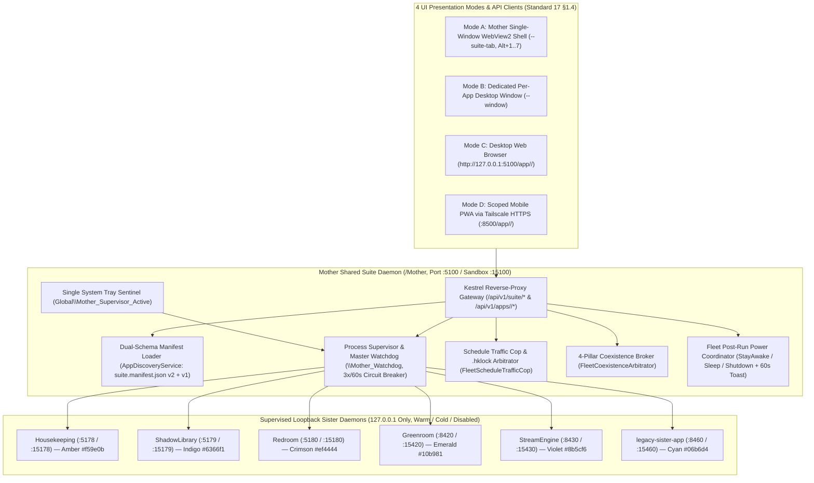
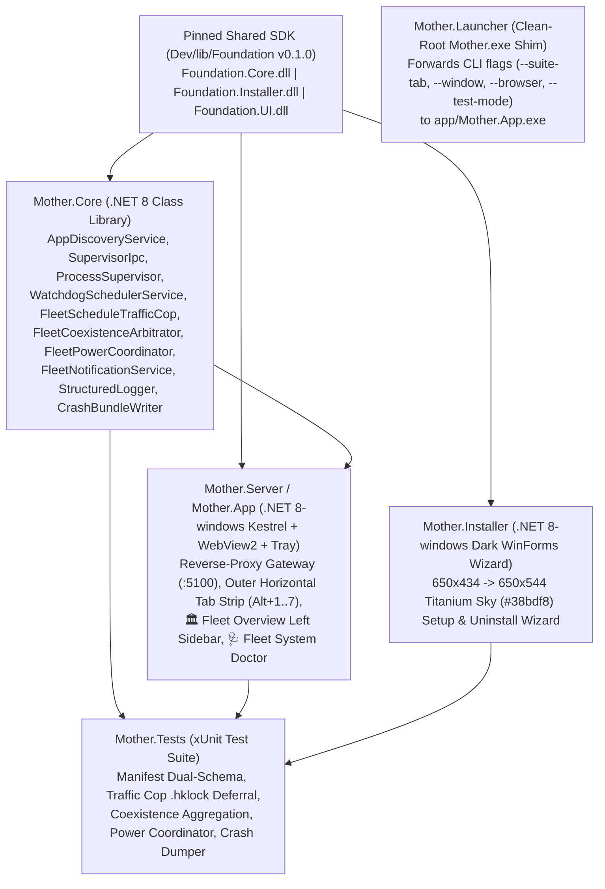

# Mother — Deep Architecture, Fleet Supervision Graph & Symbol Map (`ARCHITECTURE.md`)

> **Active Baseline Version:** `v0.1.0` (`v0.2.0` In-Dev) | **Full SemVer (`MAJOR.MINOR.PATCH`)** | **Owner:** `@devv` & `@pland` | **Clarity Editor:** `@tessa` ("The Manual Maker") | **Verified By:** `@dean` ([Standard 16 §3.5](file:///<WORKSPACE_ROOT>/<DEV_BIBLE>/16_PROJECT_DOSSIERS_AND_FEATURE_TRACKING.md))

This technical manual documents the system context, runtime process topology, assembly dependency graph, end-to-end orchestration pipelines, file and symbol lookup registry, persistence stores, failure-mode engineering, security model, testing strategy, architectural decision records (ADRs), and zero-touch extension playbooks for **`Mother`** ([`<WORKSPACE_ROOT>/Mother\`](file:///<WORKSPACE_ROOT>/Mother/)), the Single Shared Suite Daemon (`:5100`), unified system tray sentinel, reverse-proxy API gateway, schedule traffic cop, post-run power coordinator, and cross-app coexistence broker for the 6 sister applications (**Housekeeping** `:5178`, **ShadowLibrary** `:5179`, **Redroom** `:5180`, **Greenroom** `:8420`, **StreamEngine** `:8430`, and **legacy-sister-app** `:8460`).

---

## 1. System Context & Runtime Model

> [!IMPORTANT]
> **Single Shared Suite Daemon & Single Public Gateway ([Standard 08 §4–§6](file:///<WORKSPACE_ROOT>/<DEV_BIBLE>/08_APPLICATION_ARCHETYPES_AND_LIFECYCLE.md), [Standard 17 §1, §4, §5](file:///<WORKSPACE_ROOT>/<DEV_BIBLE>/17_SISTER_COMPATIBILITY_AND_FEATURE_PARITY.md))**
> `Mother` eliminates competing system tray icons, duplicate Task Scheduler watchdogs, and uncoordinated 3:00 AM disk thrashing across the workstation. Only `Mother` binds a public/LAN/Tailscale gateway port (`http://127.0.0.1:5100/`, Tailscale HTTPS `:8500`, Sandbox `:15100`). All 6 sister applications run as supervised child workers bound strictly to `127.0.0.1` loopback (`:5178..5180`, `:8420..8460`) with `--managed-by-mother` / `--managed-by-suite`, managed according to their per-app residency mode (`Warm`, `Cold`, or `Disabled`).

### Runtime Process, Threading & Residency Model
1. **Single-Instance & Supervisor Mutexes ([`v0.1.0.2026-11-04.md#L98-L100`](file:///<WORKSPACE_ROOT>/Mother/Dev/docs/plans/v0.1.0.2026-11-04.md#L98-L100)):** On startup, `Mother` acquires `Global\Mother_SingleInstance_Mutex` and `Global\Mother_Supervisor_Active`. Child sister apps inspect `Global\Mother_Supervisor_Active` (and `--managed-by-mother`) to suppress their standalone system tray icons.
2. **Per-App Residency Loop (`Warm`, `Cold`, `Disabled` — [Standard 17 §4.2](file:///<WORKSPACE_ROOT>/<DEV_BIBLE>/17_SISTER_COMPATIBILITY_AND_FEATURE_PARITY.md#L213-L222)):**
   - **`Warm`:** Spawned at `Mother` boot (`--managed-by-mother --bind 127.0.0.1 --port <internalPort>`); health-polled every `250ms` during startup and `3000ms` steady-state.
   - **`Cold` (`0 MB` RAM when idle):** Not spawned at boot. Automatically woken on UI navigation (`/app/<app-id>/`), API call (`/api/v1/apps/<app-id>/*`), or due schedule in `schedules[]`, and gracefully hibernated after `idleTimeoutMinutes` (`15m` default) once `activeJobs == 0` and `queuedJobs == 0`.
   - **`Disabled`:** Registered in `manifests\`, but skipped by boot, schedules, and background polling until enabled by the user.
3. **WebView2 Tab Virtualization (`< 35 MB` Base Footprint — [`v0.1.0.2026-11-04.md#L119-L121`](file:///<WORKSPACE_ROOT>/Mother/Dev/docs/plans/v0.1.0.2026-11-04.md#L119-L121)):** Inactive outer horizontal app tabs (`Alt+1..7`) are suspended via WebView2 `TrySuspendAsync()` so keeping all 6 sister apps registered never bloats desktop memory.

---

## 2. Project & Module Dependency Graph

Per [`Dev\docs\plans\v0.1.0.2026-11-04.md#L84-L94`](file:///<WORKSPACE_ROOT>/Mother/Dev/docs/plans/v0.1.0.2026-11-04.md#L84-L94) and [`README.md#L33-L37`](file:///<WORKSPACE_ROOT>/Mother/README.md#L33-L37), `Mother` pins **`Foundation v0.1.0`** (`Foundation.Core.dll`, `Foundation.Installer.dll`, `Foundation.UI.dll`) from [`<WORKSPACE_ROOT>/SharedLibs\Foundation\v0.1.0\`](file:///<WORKSPACE_ROOT>/SharedLibs/Foundation/v0.1.0/) into `Dev\lib\` and separates its solution (`Dev\Mother.slnx`) into 5 focused projects:

| Project / Assembly | Target Framework | Allowed References | Forbidden References |
| :--- | :--- | :--- | :--- |
| **`Mother.Core`** | `net8.0` | `Foundation.Core.dll`, `.NET 8 BCL`, `Microsoft.Data.Sqlite` | Zero WinForms/WebView2 UI dependencies; zero direct project references to sister-app repositories. |
| **`Mother.Server` / `Mother.App`** | `net8.0-windows` | `Mother.Core`, `Foundation.Core.dll`, `Foundation.UI.dll`, `ASP.NET Core Kestrel`, `Microsoft.Web.WebView2` | Zero direct file mutations inside child sister-app `data\` databases (all child control goes through `/api/v1/*` and `.coexistence.json`). |
| **`Mother.Launcher`** | `net8.0-windows` | `.NET 8 BCL` only | Zero heavy libraries at the clean release root (`<PROGRAMS_ROOT>/Mother\Mother.exe`). |
| **`Mother.Installer`** | `net8.0-windows` | `Foundation.Core.dll`, `Foundation.Installer.dll`, `System.Windows.Forms` | Zero Inno Setup (`installer.iss`) or third-party MSI dependencies ([`0532` Pillar 2](file:///<WORKSPACE_ROOT>/Mother/Dev/docs/reports/archive/v0.1.0-alpha.1.2026-11-02_0532.-.sister-app-feature-parity.md#L51)). |
| **`Mother.Tests`** | `net8.0-windows` | `Mother.Core`, `Mother.Server`, `Mother.Installer`, `Foundation.*`, `xUnit` | Zero uncontained `<PROGRAMS_ROOT>/...` access during test execution. |

---

## 3. End-to-End Data Flow per Pipeline

### Pipeline A: Dual-Schema Manifest Discovery & Residency Supervision (`AppDiscoveryService` $\rightarrow$ `ProcessSupervisor`)
1. **Directory Scan ([`v0.1.0.2026-11-04.md#L98-L100`](file:///<WORKSPACE_ROOT>/Mother/Dev/docs/plans/v0.1.0.2026-11-04.md#L98-L100)):** `AppDiscoveryService` scans `<PROGRAMS_ROOT>/Mother\manifests\*.manifest.json` as well as `--programs-dir` (`<PROGRAMS_ROOT>/*\app\suite.manifest.json` and `*/mother.manifest.json`, or `Sandbox\data\mock_programs\` in `--test-mode`).
2. **Dual-Schema Normalization ([`1715` Report §5.1](file:///<WORKSPACE_ROOT>/Mother/Dev/docs/reports/archive/v0.1.0-alpha.1.2026-11-03_1715.-.fleet-coexistence-broker-and-manifest-schema.md#L59-L60)):** To guarantee zero discovery failures across upgraded and pre-upgrade sister apps, `AppDiscoveryService` normalizes both Standard 17 `v2` `camelCase` keys (`schemaVersion: 2`, `appId`, `name`, `brandAccent`, `minSuiteVersion`, `sdkVersion`, `internalPort`, `endpoints.*`) and legacy `v1` `snake_case` keys (`schema_version`, `app_id`, `display_name`, `brand_accent` / `brand_color`, `health_endpoint`).
3. **Child Process Launch & Health Polling ([`v0.1.0.2026-11-04.md#L103-L105`](file:///<WORKSPACE_ROOT>/Mother/Dev/docs/plans/v0.1.0.2026-11-04.md#L103-L105)):** For each app whose residency is `warm` (or when a `cold` app is woken), `ProcessSupervisor` attaches the child process to a Windows Job Object ([`JobObjectGuard`](file:///<WORKSPACE_ROOT>/Foundation/Dev/src/Foundation.Core/JobObjectGuard.cs#L120-L228)), passes `--managed-by-mother --bind 127.0.0.1 --port <internalPort>`, polls `/api/v1/health` every `250ms` during startup so WebView2 never hits `ERR_CONNECTION_REFUSED`, and transitions to `3000ms` steady-state polling with a `3 crashes in 60s` circuit-breaker latch.

### Pipeline B: Fleet Schedule Traffic Cop & `.hklock` Drive Contention Arbitration (`FleetScheduleTrafficCop`)
1. **Schedule & Sentinel Poll ([`v0.1.0.2026-11-04.md#L106-L108`](file:///<WORKSPACE_ROOT>/Mother/Dev/docs/plans/v0.1.0.2026-11-04.md#L106-L108), [`1715` Report §5.3](file:///<WORKSPACE_ROOT>/Mother/Dev/docs/reports/archive/v0.1.0-alpha.1.2026-11-03_1715.-.fleet-coexistence-broker-and-manifest-schema.md#L65-L66)):** `FleetScheduleTrafficCop` polls `GET /api/v1/scheduler/status` (with `/api/scheduler/status` fallback) across active sister apps and inspects `<TargetDir>\.<app>_<pid>.hklock` sentinels via [`PidSafeLockfile.IsLockedByLiveProcess`](file:///<WORKSPACE_ROOT>/Foundation/Dev/src/Foundation.Core/PidSafeLockfile.cs#L157-L213) on all `targetDrives` / `managedRoots`.
2. **Drive Mutex Contention Detection:** If App A (e.g. `ShadowLibrary` bit-rot scrub on `E:`) is actively running or holding a live `.shadowlibrary_<pid>.hklock` on `E:`, and App B (e.g. `Housekeeping` or `Redroom`) has a scheduled job about to fire targeting `E:`, the Traffic Cop detects the physical drive collision.
3. **Automatic Schedule Deferral:** `FleetScheduleTrafficCop` dispatches `POST /api/v1/scheduler/defer` (`{ "minutes": 30, "reason": "Suite Drive I/O Mutex: E: locked by shadowlibrary" }`) to App B, logs the deferral in the Unified Log Drawer (`Ctrl+\``), and emits a Fleet Notification.

### Pipeline C: 4-Pillar Fleet Coexistence Broker (`FleetCoexistenceArbitrator`)
1. **Online & Offline Coexistence Aggregation ([`v0.1.0.2026-11-04.md#L109-L113`](file:///<WORKSPACE_ROOT>/Mother/Dev/docs/plans/v0.1.0.2026-11-04.md#L109-L113), [`FEATURES.md#L27-L34`](file:///<WORKSPACE_ROOT>/Mother/FEATURES.md#L27-L34)):** `FleetCoexistenceArbitrator` polls `GET /api/v1/coexistence/status` on running sister apps and reads `<Root>\.coexistence.json` manifests on shared roots when a `Cold` peer is hibernating.
2. **Conflict Matrix & 1-Click Auto-Align:** Exposes `GET /api/v1/suite/coexistence/status` for the **Fleet Coexistence & Shared Storage Matrix** in `🏛️ Fleet Overview`. When the user clicks **`Align Fleet Settings`** (or enables `AutoAlignWithSisterApps`, default `false`), `POST /api/v1/suite/coexistence/apply-recommendations` forwards the non-conflicting preset (`Co-Audit Zero-Rewrite Parity`, `Align Housekeeping Media Library Parity`, `Use Verified Sister .hash & Manifest Cache`) to the target child apps and updates `<Root>\.coexistence.json`.

### Pipeline D: Fleet-Wide Post-Run Power Coordinator (`FleetPowerCoordinator`)
1. **Aggregate Queue Monitoring ([`v0.1.0.2026-11-04.md#L114-L116`](file:///<WORKSPACE_ROOT>/Mother/Dev/docs/plans/v0.1.0.2026-11-04.md#L114-L116), [`0532` Pillar 4](file:///<WORKSPACE_ROOT>/Mother/Dev/docs/reports/archive/v0.1.0-alpha.1.2026-11-02_0532.-.sister-app-feature-parity.md#L53)):** Individual sister apps never invoke OS `Sleep` or `Shutdown` directly. Instead, `FleetPowerCoordinator` monitors `activeJobs` and `queuedJobs` across all registered sister apps (plus active broadcast/recording state in `StreamEngine :8430`).
2. **60-Second Cancellable Countdown:** When the outer top-bar selector is set to `Sleep` or `Shutdown` and the fleet transitions from busy (`>= 1` active job) to `0` active and `0` queued jobs across **every** registered app, `FleetPowerCoordinator` starts a 60-second cancellable countdown with a Windows Tray Toast and Discord Rich Embed before invoking OS Sleep/Shutdown (strictly no-op when `--test-mode` or `--dry-run` is active).

---

## 4. Complete File & Symbol Lookup Registry (`<= 400 LOC` Hard Gate)

### 4.1 Current On-Disk Dossiers, Blueprints & Archived Reports (`v0.1.0` Baseline)

| File Path (Relative to `<WORKSPACE_ROOT>/Mother\`) | Exact LOC | `<= 400 LOC` Status | Primary Symbols / Sections | Role & Responsibility |
| :--- | :---: | :---: | :--- | :--- |
| [`active.state`](file:///<WORKSPACE_ROOT>/Mother/active.state#L1-L13) | `13` | ✅ `PASS` | `state: "active"`, `version: "0.1.0"` | Canonical Tier A lifecycle state marker. |
| [`README.md`](file:///<WORKSPACE_ROOT>/Mother/README.md#L1-L46) | `46` | ✅ `PASS` | Root Quartet #1 | Quickstart, `:5100` gateway overview, `Foundation v0.1.0` pin, and manual links. |
| [`FEATURES.md`](file:///<WORKSPACE_ROOT>/Mother/FEATURES.md#L1-L34) | `34` | ✅ `PASS` | Root Quartet #2 | Feature index and 6-sister-app Cross-App Operability & Conflict Matrix (`:5178..8460`). |
| [`ROADMAP.md`](file:///<WORKSPACE_ROOT>/Mother/ROADMAP.md#L1-L31) | `31` | ✅ `PASS` | Root Quartet #3 | North Star goal, `v0.1.0` -> `v0.2.0` -> `v1.0.0` trajectory, and milestone checklist. |
| [`CHANGELOG.md`](file:///<WORKSPACE_ROOT>/Mother/CHANGELOG.md#L1-L22) | `22` | ✅ `PASS` | Root Quartet #4 | Keep a Changelog version history (`v0.1.0`, `v0.1.0-alpha.1`). |
| [`Dev/docs/plans/v0.1.0.2026-11-04.md`](file:///<WORKSPACE_ROOT>/Mother/Dev/docs/plans/v0.1.0.2026-11-04.md#L1-L160) | `160` | ✅ `PASS` | `@pland` Master Blueprint (`@dean PASS`) | Locked `v0.1.0` architecture and phased task specification for `@devv`. |
| [`Dev/docs/reports/archive/v0.1.0-alpha.1.2026-11-02_0448.-.scaffold-and-readiness-audit.md`](file:///<WORKSPACE_ROOT>/Mother/Dev/docs/reports/archive/v0.1.0-alpha.1.2026-11-02_0448.-.scaffold-and-readiness-audit.md#L1-L181) | `181` | ✅ `PASS` | `@inspecter` Audit Report (`0448`) | Initial 6-folder scaffold, crash-bundle, clean-root, and installer compliance audit. |
| [`Dev/docs/reports/archive/v0.1.0-alpha.1.2026-11-02_0532.-.sister-app-feature-parity.md`](file:///<WORKSPACE_ROOT>/Mother/Dev/docs/reports/archive/v0.1.0-alpha.1.2026-11-02_0532.-.sister-app-feature-parity.md#L1-L73) | `73` | ✅ `PASS` | `@inspecter` Parity Report (`0532`) | 12 locked-in fleet parity pillars (Power Coordinator, `\Mother_Watchdog`, Traffic Cop, Orthogonal Tabs). |
| [`Dev/docs/reports/archive/v0.1.0-alpha.1.2026-11-03_1715.-.fleet-coexistence-broker-and-manifest-schema.md`](file:///<WORKSPACE_ROOT>/Mother/Dev/docs/reports/archive/v0.1.0-alpha.1.2026-11-03_1715.-.fleet-coexistence-broker-and-manifest-schema.md#L1-L72) | `72` | ✅ `PASS` | `@inspecter` Coexistence Report (`1715`) | Dual-schema `camelCase`/`snake_case` manifest loader, `FleetCoexistenceArbitrator`, and `.hklock` Traffic Cop. |

### 4.2 Planned C# / Web / Installer Slices in `Dev\` ([`v0.1.0.2026-11-04.md#L84-L133`](file:///<WORKSPACE_ROOT>/Mother/Dev/docs/plans/v0.1.0.2026-11-04.md#L84-L133))

| Planned Slice Path (Relative to `Dev\`) | Target LOC Bound | `<= 400 LOC` Gate | Primary Exported Symbols | Role & Responsibility |
| :--- | :---: | :---: | :--- | :--- |
| `Mother.Core/Discovery/AppDiscoveryService.cs` | `<= 250 LOC` | ✅ Enforced | `AppDiscoveryService`, `SuiteAppManifest` | Dual-schema `v2` (`suite.manifest.json`) & `v1` (`mother.manifest.json`) parser (`camelCase` + `snake_case`). |
| `Mother.Core/IPC/SupervisorIpc.cs` | `<= 200 LOC` | ✅ Enforced | `SupervisorIpc` | Acquires `Global\Mother_SingleInstance_Mutex` and `Global\Mother_Supervisor_Active`. |
| `Mother.Core/Diagnostics/StructuredLogger.cs` | `<= 200 LOC` | ✅ Enforced | `StructuredLogger` | Standard 15 §5.1 ISO-8601 logger with `10 MB × 5` rotation, 30-day pruning, and 50-line ring buffer. |
| `Mother.Core/Diagnostics/CrashBundleWriter.cs` | `<= 200 LOC` | ✅ Enforced | `CrashBundleWriter` (wraps `Foundation.Core.CrashBundleService`) | Writes sanitized Zero-PII `crash_YYYYMMDD_HHMMSS_v0.1.0.json` dumps (max 20 retained). |
| `Mother.Core/Supervisor/ProcessSupervisor.cs` | `<= 300 LOC` | ✅ Enforced | `ProcessSupervisor`, `ManagedAppState` | Manages `Warm`/`Cold`/`Disabled` residency, `250ms`/`3000ms` health polling, 5s drain, and `3x/60s` crash latch. |
| `Mother.Core/Supervisor/WatchdogSchedulerService.cs` | `<= 200 LOC` | ✅ Enforced | `WatchdogSchedulerService` | Registers and verifies the single `\Mother_Watchdog` Windows Task Scheduler entry. |
| `Mother.Core/Orchestration/FleetScheduleTrafficCop.cs` | `<= 300 LOC` | ✅ Enforced | `FleetScheduleTrafficCop`, `DriveContentionDecision` | Polls `/api/v1/scheduler/status` and disk `*.hklock` sentinels; issues `POST /api/v1/scheduler/defer` (`30m`). |
| `Mother.Core/Orchestration/FleetCoexistenceArbitrator.cs` | `<= 350 LOC` | ✅ Enforced | `FleetCoexistenceArbitrator`, `FleetCoexistenceReport` | Polls `/api/v1/coexistence/status` & `<Root>\.coexistence.json`; dispatches 1-click Fleet `Auto-Align`. |
| `Mother.Core/Orchestration/FleetPowerCoordinator.cs` | `<= 250 LOC` | ✅ Enforced | `FleetPowerCoordinator`, `PostRunPowerAction` | Coordinates `StayAwake / Sleep / Shutdown` after all 6 sister apps hit `0` active/queued jobs (+ `60s` cancel toast). |
| `Mother.Core/Notifications/FleetNotificationService.cs` | `<= 250 LOC` | ✅ Enforced | `FleetNotificationService` | Dispatches Win32 Tray Toasts and Titanium Sky (`#38bdf8`) Discord Rich Embed webhooks. |
| `Mother.Server/Program.cs` & `Endpoints/SuiteEndpoints.cs` | `<= 300 LOC` | ✅ Enforced | `SuiteEndpoints` | Kestrel `:5100` reverse proxy (`/api/v1/suite/*`, `/api/v1/apps/<app-id>/*`, `/app/<app-id>/*`) & Tailscale `:8500`. |
| `Mother.App/MainForm.cs` & `Mother.Server/wwwroot/*` | `<= 350 LOC` | ✅ Enforced | `MainForm`, `index.html`, `app.js`, `styles.css` | Single-Window WebView2 Host, Outer Horizontal App Tab Strip (`Alt+1..7`), and `🏛️ Fleet Overview` Left Sidebar. |
| `Mother.Launcher/Program.cs` | `<= 100 LOC` | ✅ Enforced | `Program` | Root `Mother.exe` clean-release launcher shim forwarding CLI args to `app\Mother.App.exe`. |
| `Mother.Installer/InstallerWizardForm.cs` | `<= 150 LOC` | ✅ Enforced | `MotherInstallerProgram` (powered by `Foundation.Installer.dll`) | `650×434` $\rightarrow$ `650×544` Titanium Sky (`#38bdf8`) Setup & Uninstall Wizard. |

---

## 5. Persistence Stores, SQLite Tables & Settings Ownership

Per [Standard 17 §4.1](file:///<WORKSPACE_ROOT>/<DEV_BIBLE>/17_SISTER_COMPATIBILITY_AND_FEATURE_PARITY.md#L178-L188), [Standard 18](file:///<WORKSPACE_ROOT>/<DEV_BIBLE>/18_DATA_DICTIONARY_AND_SCHEMA_LOOKUP.md), and [Standard 19](file:///<WORKSPACE_ROOT>/<DEV_BIBLE>/19_SETTINGS_MANIFESTS_LOCKS_AND_NETWORK_SAFETY.md), `Mother` owns the following suite-level persistence files under `<PROGRAMS_ROOT>/Mother\` (or `Sandbox\data\` in `--test-mode`):

| Store / File Path | Format & Pragma / Encoding | Owning `Mother` Slice | Stored Fields & Responsibility |
| :--- | :--- | :--- | :--- |
| **`manifests\<app-id>.manifest.json`** | UTF-8 No-BOM `camelCase` JSON (`schemaVersion: 2`) | `AppDiscoveryService` | Dynamic registry of installed sister apps (`housekeeping`, `shadowlibrary`, `redroom`, `greenroom`, `streamengine`, `legacy-sister-app`) dropped by each sister-app installer. |
| **`data\settings.json`** (`suite.config.json`) | Atomic `.tmp` $\rightarrow$ `.bak` JSON via `GranularSettingsManager` | `Mother.Core` Config | Stores `schemaVersion` (`2`), `port` (`5100`), `postRunPowerAction` (`"StayAwake" \| "Sleep" \| "Shutdown"`), `autoAlignWithSisterApps` (`false`), per-app residency overrides (`residencyOverrides`), and window bounds. |
| **`data\config_history\settings_*.json`** | 20-Snapshot JSON Ring Buffer | `GranularSettingsManager` | Supports `Ctrl+S` 1-click config rollback across the 20 most recent suite configuration saves. |
| **`data\secrets.dpapi`** | Windows DPAPI (`CurrentUser`) | `DpapiSecretStore` | Stores encrypted `discord_webhook_url` and optional gateway tokens at rest. |
| **`data\mother.db`** | SQLite `WAL` (`busy_timeout=5000`, `synchronous=NORMAL`) | `SqliteWalPool` | Stores historical fleet health rollups (`fleet_health_events`), schedule deferral audit logs (`schedule_deferrals`), and notification delivery history (`notification_history`). |
| **`<SharedRoot>\.coexistence.json`** | UTF-8 No-BOM `camelCase` JSON | `FleetCoexistenceArbitrator` | Offline shared-root manifest recording which sister apps manage a vault/media root and their active archive/hash settings. |
| **`logs\mother_*.log` & `logs\crashes\crash_*.json`** | `10 MB × 5` Rotating UTF-8 Logs + JSON Crash Bundles | `StructuredLogger` & `CrashBundleWriter` | ISO-8601 structured daemon logs (30-day pruning) and sanitized 50-line ring-buffer crash bundles (max 20 retained). |

---

## 6. Failure Modes, Concurrency & Resilience Engineering

| Failure Mode / Contention Scenario | Detection Mechanism in `Mother` | Automated Recovery & Arbitration Path | Spec / Blueprint Reference |
| :--- | :--- | :--- | :--- |
| **Child Sister Daemon Crashes or Hangs** | `ProcessSupervisor` polls child `healthEndpoint` (`/api/v1/health`) every `3000ms` and monitors `Process.Exited`. | Automatically restarts the child worker with `--managed-by-mother`. If a child crashes **3 times within 60 seconds**, `ProcessSupervisor` trips the **Crash-Loop Circuit Breaker**, marks the app tab `ERROR` (red dot), writes a fleet diagnostic alert, and halts endless restart loops. | [`v0.1.0.2026-11-04.md#L103-L105`](file:///<WORKSPACE_ROOT>/Mother/Dev/docs/plans/v0.1.0.2026-11-04.md#L103-L105) |
| **WebView2 `ERR_CONNECTION_REFUSED` on Cold-Start or Boot** | User clicks a `Cold` or starting app tab before Kestrel/FastAPI finishes binding `127.0.0.1:<internalPort>`. | `ProcessSupervisor` polls `/api/v1/health` at a fast `250ms` interval during child startup and holds the reverse-proxy request / displays a sleek Titanium Sky loading state until `HTTP 200 OK` is confirmed. | [`v0.1.0.2026-11-04.md#L105`](file:///<WORKSPACE_ROOT>/Mother/Dev/docs/plans/v0.1.0.2026-11-04.md#L105), [`Std 17 §4.2`](file:///<WORKSPACE_ROOT>/<DEV_BIBLE>/17_SISTER_COMPATIBILITY_AND_FEATURE_PARITY.md#L220) |
| **Two Sister Apps Schedule Heavy Disk Jobs on the Same Drive at 3:00 AM** | `FleetScheduleTrafficCop` detects overlapping `targetDrives` in `/api/v1/scheduler/status` or a live `<Dir>\.<app>_<pid>.hklock` sentinel on disk. | Issues `POST /api/v1/scheduler/defer` (`{ "minutes": 30 }`) to the secondary app so the primary job completes with 100% disk I/O bandwidth and zero seek thrashing. | [`v0.1.0.2026-11-04.md#L106-L108`](file:///<WORKSPACE_ROOT>/Mother/Dev/docs/plans/v0.1.0.2026-11-04.md#L106-L108), [`1715` Report §1.3](file:///<WORKSPACE_ROOT>/Mother/Dev/docs/reports/archive/v0.1.0-alpha.1.2026-11-03_1715.-.fleet-coexistence-broker-and-manifest-schema.md#L24-L25) |
| **Premature OS Sleep/Shutdown While Another Sister App Is Encoding or Scrubbing** | `FleetPowerCoordinator` checks aggregate `activeJobs + queuedJobs` across all 6 sister apps plus `StreamEngine` broadcast state. | Blocks OS Sleep/Shutdown until **every** registered sister app reaches `0` active/queued jobs, then displays a **60-second cancellable countdown toast** before invoking power state change. | [`v0.1.0.2026-11-04.md#L21-L22`](file:///<WORKSPACE_ROOT>/Mother/Dev/docs/plans/v0.1.0.2026-11-04.md#L21-L22), [`0532` Pillar 4](file:///<WORKSPACE_ROOT>/Mother/Dev/docs/reports/archive/v0.1.0-alpha.1.2026-11-02_0532.-.sister-app-feature-parity.md#L17) |
| **Heterogeneous `camelCase` vs `snake_case` Manifests During Fleet Rollout** | `AppDiscoveryService` encounters legacy `mother.manifest.json` (`app_id`, `brand_color`, `endpoints.health`) alongside `v2` `suite.manifest.json` (`appId`, `brandAccent`). | Dual-schema tolerant parser maps both `camelCase` and `snake_case` properties seamlessly and falls back to canonical `/api/v1/*` routes on `port`. | [`1715` Report §5.1](file:///<WORKSPACE_ROOT>/Mother/Dev/docs/reports/archive/v0.1.0-alpha.1.2026-11-03_1715.-.fleet-coexistence-broker-and-manifest-schema.md#L59-L60) |
| **Windows Explorer (`explorer.exe`) Restart Hides System Tray Icon** | Win32 message loop listens for registered window message ` RegisterWindowMessage("TaskbarCreated")`. | Automatically re-registers Mother's single system tray icon (`Global\Mother_Supervisor_Active`) whenever Explorer restarts. | [`Std 17 §3.2 (SIS-10)`](file:///<WORKSPACE_ROOT>/<DEV_BIBLE>/17_SISTER_COMPATIBILITY_AND_FEATURE_PARITY.md#L116) |

---

## 7. Security & Privacy Model

1. **Single Public Gateway & Loopback-Only Child Isolation ([Standard 17 §1.1](file:///<WORKSPACE_ROOT>/<DEV_BIBLE>/17_SISTER_COMPATIBILITY_AND_FEATURE_PARITY.md#L11-L16)):**
   - Only `Mother` listens on `:5100` (and Tailscale Serve HTTPS `:8500`). All child sister workers launched with `--managed-by-mother` bind strictly to `127.0.0.1` (`:5178..5180`, `:8420..8460`), reducing the workstation's LAN/Tailscale attack surface to a single audited gateway.
2. **DPAPI Webhook & Secret Encryption:**
   - Outbound Discord webhook URLs and any gateway credentials are encrypted via `Foundation.Core.DpapiSecretStore` (`data\secrets.dpapi`, `DataProtectionScope.CurrentUser`).
3. **Fail-Closed `--test-mode` Sandbox Isolation ([Standard 02](file:///<WORKSPACE_ROOT>/<DEV_BIBLE>/02_SANDBOXING_AND_TESTING.md)):**
   - Running `Mother.exe --test-mode --programs-dir .\data\mock_programs --data-dir .\data --log-dir .\logs --port 15100` isolates all manifest discovery, health polling, and power coordination strictly inside `<WORKSPACE_ROOT>/Mother\Sandbox\`. OS Sleep/Shutdown and `\Mother_Watchdog` Task Scheduler mutations are hard-disabled in `--test-mode` and `--dry-run`.
4. **4-Pillar Zero-PII Signed Installer ([Standard 03 §5](file:///<WORKSPACE_ROOT>/<DEV_BIBLE>/03_VERSIONING_AND_RELEASES.md)):**
   - `Mother-Setup-v0.1.0-win-x64.exe` is compiled with `DebugType=none`, `PathMap` sanitization, Authenticode code-signing, and zero developer path or secret leaks.

---

## 8. Testing Strategy Map

| Verification Layer | Target Components Covered | Key Assertions & Acceptance Criteria | Execution Command |
| :--- | :--- | :--- | :--- |
| **xUnit Unit Tests (`Mother.Tests`)** | `AppDiscoveryService`, `FleetScheduleTrafficCop`, `FleetCoexistenceArbitrator`, `FleetPowerCoordinator`, `CrashBundleWriter` | Parses all 6 sister manifest shapes (`v2` `camelCase` + `v1` `snake_case`), defers overlapping drive schedules when `.hklock` is active, aggregates `.coexistence.json` conflicts, and verifies 60s power countdown state machine. | `dotnet test "<WORKSPACE_ROOT>/Mother\Dev\Mother.slnx" -c Release` |
| **Headless Sandbox Self-Test (`--test-mode --headless`)** | Full `Mother.exe` Startup, Mutexes, Mock Discovery, Health Poll & Traffic Cop | Acquires sandbox mutex, discovers mock sister manifests in `Sandbox\data\mock_programs`, executes traffic-cop & coexistence pass, writes structured ISO-8601 logs to `Sandbox\logs\`, and exits deterministically with code `0`. | `<WORKSPACE_ROOT>/Mother\Sandbox\Mother.exe --test-mode --headless --programs-dir "<WORKSPACE_ROOT>/Mother\Sandbox\data\mock_programs" --data-dir "<WORKSPACE_ROOT>/Mother\Sandbox\data" --config "<WORKSPACE_ROOT>/Mother\Sandbox\data\config.json" --log-dir "<WORKSPACE_ROOT>/Mother\Sandbox\logs" --port 15100` |
| **Live Sandbox UI & DOM Geometry Verification** | Outer Horizontal Tab Strip (`Alt+1..7`), `🏛️ Fleet Overview` Left Sidebar, `Ctrl+\`` Log Drawer, `Ctrl+K` Omni-Search | Launches `Mother.exe` on `:15100`, captures `1920x1080` CDP screenshots, verifies `getBoundingClientRect` (zero vertical shell stacking, zero clipped buttons, full-height `220px`/`56px` sidebar rail), and tests tab switching. | Live CDP / Sandbox UI walkthrough per [Standard 02 §6.4](file:///<WORKSPACE_ROOT>/<DEV_BIBLE>/02_SANDBOXING_AND_TESTING.md). |
| **4-Pillar Installer Audit (`audit_installer.ps1`)** | `Mother-Setup-v0.1.0-win-x64.exe` (`Installers\` & `<WORKSPACE_ROOT>/Installers\`) | Verifies single-file `.exe`, Authenticode signature, `--test-mode` install/verify/upgrade/uninstall lifecycle, Clean Release Root (`Mother.exe` + `app\` + `scripts\`), and `FindingCount: 0` PII scan. | `powershell -ExecutionPolicy Bypass -File "%USERPROFILE%\.gemini\config\skills\dev\scripts\audit_installer.ps1" -InstallerPath "<WORKSPACE_ROOT>/Mother\Installers" -ExpectedVersion "0.1.0"` |

---

## 9. ADR Design Decisions Log

| ADR ID | Date | Version | Context & Problem | Decision Made | Consequences & Trade-Offs |
| :--- | :---: | :---: | :--- | :--- | :--- |
| **`ADR-001`** | `2026-11-02` | `v0.1.0` | All 6 sister apps standardize on a collapsible **Left Vertical Sidebar Rail (`220px`/`56px`) + `48px` Slim Topbar**. Putting a second vertical sidebar or second inner horizontal tab strip in `Mother` would create visual collision and waste vertical screen real estate. | Assign `Mother` the **Top Horizontal Axis** (`Alt+1..7` outer app tab strip with Titanium Sky `#38bdf8` accent + global fleet controls), while each child app (and `🏛️ Fleet Overview` itself) owns the **Left Vertical Axis** ([`0532` Pillar 7](file:///<WORKSPACE_ROOT>/Mother/Dev/docs/reports/archive/v0.1.0-alpha.1.2026-11-02_0532.-.sister-app-feature-parity.md#L20)). | Orthogonal 2-axis navigation with zero double-sidebar or double-topbar clutter. |
| **`ADR-002`** | `2026-11-02` | `v0.1.0` | Allowing individual sister apps to trigger OS `Sleep`/`Shutdown` or register separate Task Scheduler watchdogs risked putting the PC to sleep while another sister app was mid-write on a 50 GB archive. | Centralize **Fleet Post-Run Power Coordination (`StayAwake/Sleep/Shutdown`)** and the single **`\Mother_Watchdog`** Task Scheduler entry exclusively inside `Mother` ([`0532` Pillars 4 & 5](file:///<WORKSPACE_ROOT>/Mother/Dev/docs/reports/archive/v0.1.0-alpha.1.2026-11-02_0532.-.sister-app-feature-parity.md#L17-L18)). | OS power actions occur only after all 6 sister apps report `0` active/queued jobs and a 60s cancellable toast completes. |
| **`ADR-003`** | `2026-11-03` | `v0.1.0` | Existing production installs of sister apps in `<PROGRAMS_ROOT>/...` carry legacy `snake_case` `mother.manifest.json` files while newer builds emit Standard 17 `v2` `camelCase` `suite.manifest.json`. | Implement a **Dual-Schema Tolerant Loader** in `AppDiscoveryService` plus `.hklock`-aware schedule deferral and `FleetCoexistenceArbitrator` ([`1715` Report §5](file:///<WORKSPACE_ROOT>/Mother/Dev/docs/reports/archive/v0.1.0-alpha.1.2026-11-03_1715.-.fleet-coexistence-broker-and-manifest-schema.md#L57-L66)). | `Mother` discovers and supervises all 6 sister apps regardless of individual upgrade order. |
| **`ADR-004`** | `2026-11-04` | `v0.1.0` | Sister apps need to verify `minSuiteVersion` compatibility in `suite.manifest.json` at a single glance without complex pre-release suffix ordering rules. | Adopt strict suffix-free 3-part **Full Semantic Versioning (`MAJOR.MINOR.PATCH`)** (`v0.1.0` $\rightarrow$ `v0.2.0` $\rightarrow$ `v1.0.0`) for `Mother` and `Foundation` ([Standard 03 §1](file:///<WORKSPACE_ROOT>/<DEV_BIBLE>/03_VERSIONING_AND_RELEASES.md)). | Instant `minSuiteVersion` and `sdkVersion` comparison across the entire suite. |

---

## 10. Zero-Touch Extension Playbooks

### Playbook 1: Onboarding a New Sister Application into the `Mother` Suite (Zero Code Changes in `Mother`)
1. Package a valid `app\suite.manifest.json` (`schemaVersion: 2`, `suiteId: "mother"`, `minSuiteVersion: "0.1.0"`, `sdkVersion: "0.1.0"`, unique `appId`, `internalPort`, `sandboxPort`, `brandAccent`, `endpoints`, and `targetDrives`) inside the new app's `app\` directory.
2. Build the new app's installer using `Foundation.Installer.dll` (`InstallerEngineCore`), which automatically copies `app\suite.manifest.json` into `<PROGRAMS_ROOT>/Mother\manifests\<appId>.manifest.json` and calls `POST http://127.0.0.1:5100/api/v1/suite/apps/reload`.
3. `Mother` dynamically adds the new app's outer horizontal tab, tray residency menu (`Warm / Cold / Disabled`), `\Mother_Watchdog` health polling, Drive Traffic Cop arbitration, and Post-Run Power monitoring with **zero code modifications or recompilation of `Mother`**.

### Playbook 2: Adding a New Coexistence Rule to `FleetCoexistenceArbitrator`
1. Expose the domain capability and current setting state from the child sister app's `GET /api/v1/coexistence/status` endpoint and `<Root>\.coexistence.json`.
2. Add the declarative conflict rule descriptor to `FleetCoexistenceArbitrator.cs` (`<= 350 LOC`) mapping the conflict condition to its 1-click recommendation preset payload (`POST /api/v1/coexistence/apply-recommendations`).
3. Add a unit test in `Mother.Tests` verifying both online HTTP polling and offline `.coexistence.json` fallback detection.
