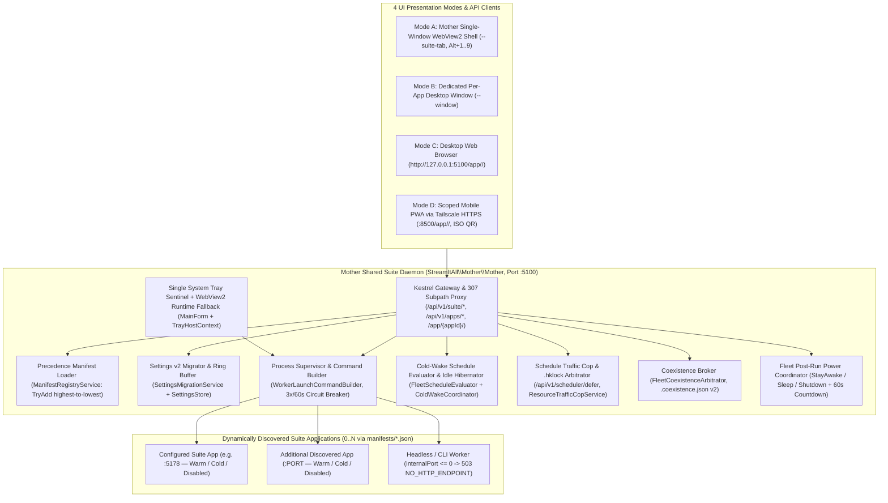
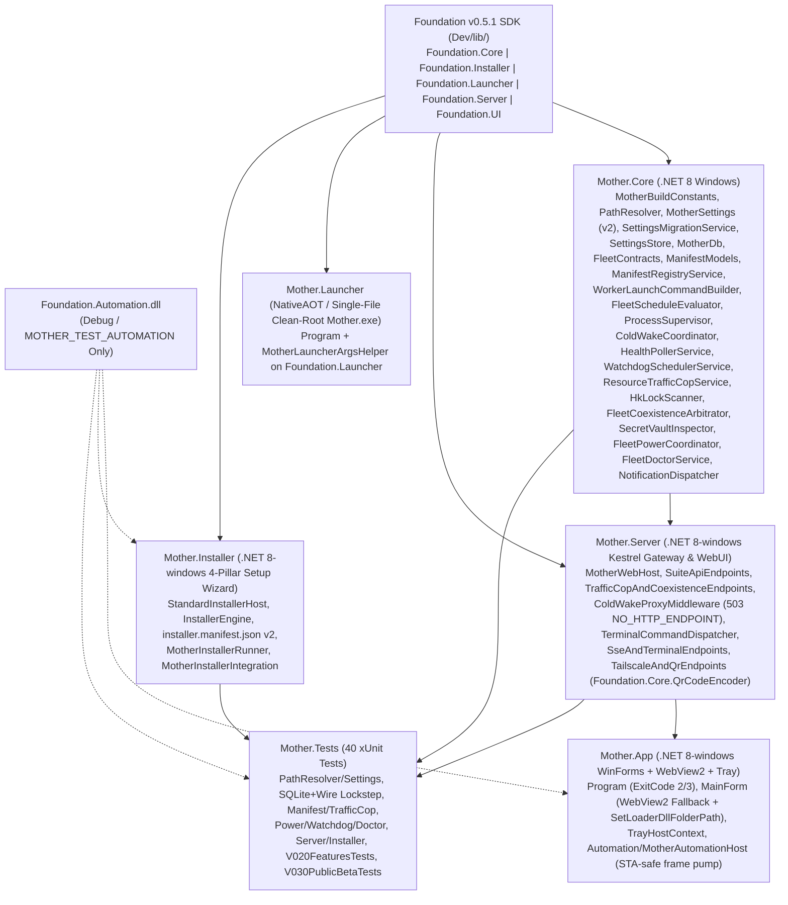

# Mother — Deep Architecture, Fleet Supervision Graph & Symbol Map (`ARCHITECTURE.md`)

> **Active Baseline Version:** `v0.3.0` (`MPL-2.0`) | **Full SemVer (`MAJOR.MINOR.PATCH[-tag]`)** | **SDK Pin:** `Foundation v0.5.1`

This technical manual documents the system context, runtime process topology, assembly dependency graph, end-to-end orchestration pipelines, file and symbol lookup registry, persistence stores, failure-mode engineering, security model, testing strategy, and architectural decision records (ADRs) for **`Mother`**, the Universal Single Shared Suite Daemon (`:5100`), unified system tray sentinel, reverse-proxy API gateway, autonomous Cold-Wake scheduler, schedule traffic cop, post-run power coordinator, and cross-app coexistence broker for dynamically discovered suite applications.

---

## 1. System Context & Runtime Model

> [!IMPORTANT]
> **Universal Single Shared Suite Daemon & Dynamic Zero-App Core**
> `Mother` (`%LOCALAPPDATA%\Programs\StreamItAll\Mother\Mother\`) contains zero hardcoded application identities or legacy fallback lists. When `0` suite manifests exist on a fresh install, `Mother` boots cleanly into an actionable **0-App Empty State**, renders only the primary `[Mother]` outer tab (`Alt+1`), and returns `overall: "pass"` from `FleetDoctorService`. Every discovered application binds strictly to `127.0.0.1` loopback (`--managed-by-mother --bind 127.0.0.1 --port <effectivePort>`) behind `Mother`'s reverse-proxy gateway.

### Runtime Process, Threading & Containment Model
1. **3-Mode Sandbox & Isolation Containment (`PathResolver` + `Foundation.Core`):**
   - **Stage 1 (`IsStage1Isolated`):** Activated by `APP_ISOLATED_TEST=1` or non-default `--data-dir` (when `FOUNDATION_SANDBOX_ROOT` is inactive); suppresses host Registry (`NoOpPlatformRegistry`), host Task Scheduler, host `DriveInfo`, and simulates OS sleep inhibition.
   - **Stage 2 (`IsSandboxActive`):** Activated by `FOUNDATION_SANDBOX_ROOT` + 4-drive `SANDBOX_*_DRIVE` bindings (without `APP_ISOLATED_TEST=1`); routes registry lookups/writes to `JsonHivePlatformRegistry` (`registry.hive.json`), resolves folders through `KnownFolderPaths`, enforces `SandboxEnvironmentSeam.AssertSandboxPathIfActive` (`ExitCode = 3` on escape attempts), and sets `ShouldSuppressLiveHostMutations = true`.
   - **Production:** Full workstation operation bound strictly to loopback or optional Tailscale CGNAT (`100.64.0.0/10`) with live registry, `\Mother_Watchdog`, and DPAPI secrets.
2. **IPC & Clean-Root NativeAOT/Trimmed Launcher (`SupervisorIpc`, `Mother.Launcher`):**
   - `Mother.exe` compiles directly against `Foundation.Launcher` (`net8.0-windows`, zero WinForms, auto-detected MSVC `-p:PublishAot=true` or `-p:PublishSingleFile=true -p:PublishTrimmed=true -p:TrimMode=partial`) and delegates argument rebasing/wait policy through `MotherLauncherArgsHelper` (`--diagnose`, `--automation-port`, `--automation-token`, `--programs-dir`, `--suite-tab`, `--window`, `--browser`).
   - `SupervisorIpc` uses deterministic isolated mutex/pipe hashes (`Local\Mother.Isolated.<hash>`) when Stage 1 or Stage 2 isolation is active.
3. **WebView2 Hosting & Missing-Runtime Fallback (`MainForm`):**
   - `MainForm` configures `CoreWebView2Environment.SetLoaderDllFolderPath` once for self-contained `app\runtimes\win-x64\native\WebView2Loader.dll` resolution, isolates browser state under `DataDirectory\webview2`, and renders a styled dark-theme fallback card (with local URL copy, browser launch, runtime download link, and Retry) if Evergreen WebView2 is absent.
4. **Release Fail-Closed Automation Boundary (`MotherAutomationHost`):**
   - `Foundation.Automation.dll` is linked strictly under `Debug` or `-p:MotherTestAutomation=true` (`MOTHER_TEST_AUTOMATION`). Plain Release builds strip `Foundation.Automation.*` completely and exit with **`ExitCode = 2`** if `--automation-port` or `--automation-token` is passed.

---

## 2. Project & Module Dependency Graph

`Mother` pins **`Foundation v0.5.1`** (`Foundation.Core.dll`, `Foundation.Installer.dll`, `Foundation.Launcher.dll`, `Foundation.Server.dll`, `Foundation.UI.dll`, plus conditional Debug/Test `Foundation.Automation.dll` and strictly 3 vanilla web assets under `wwwroot\vendor\foundation\`) synced pre-build from SharedLibs via `sync_foundation_sdk.py --sync-consumer`:

| Project / Assembly | Target Framework | Allowed Dependencies | Release Containment / Boundary |
| :--- | :--- | :--- | :--- |
| **`Mother.Core`** | `net8.0-windows` | `Foundation.Core.dll`, `Microsoft.Data.Sqlite`, DPAPI | Zero WinForms/WebView2 UI dependencies; zero hardcoded host paths or sister apps. |
| **`Mother.Server`** | `net8.0-windows` | `Mother.Core`, `Foundation.Core.dll` (`QrCodeEncoder`), ASP.NET Core | Reverse-proxy and `.coexistence.json` only; zero direct writes into child app DBs. |
| **`Mother.App`** | `net8.0-windows` | `Mother.Core`, `Mother.Server`, `Foundation.*`, `Microsoft.Web.WebView2` | Self-contained `win-x64` (untrimmed); `Foundation.Automation` compiled out in Release. |
| **`Mother.Launcher`** | `net8.0-windows` | `Foundation.Launcher.dll` (`Private=true`) | Zero WinForms, zero reflection `AssemblyResolve`; NativeAOT-compatible root shim. |
| **`Mother.Installer`** | `net8.0-windows` | `Foundation.Core.dll.gz`, `Foundation.Installer.dll.gz`, `installer.manifest.json` | Single-EXE 4-pillar installer; `Foundation.Automation.dll.gz` excluded in Release. |
| **`Mother.Tests`** | `net8.0-windows` | `Mother.*`, `Foundation.*` (incl. `Foundation.Automation`), xUnit, `TestHost` | `APP_ISOLATED_TEST=1` Stage 1 isolated suite (`40/40` passing, `0` warnings). |

---

## 3. End-to-End Data Flow per Pipeline

### Pipeline A: Discovery Precedence & Dynamic Supervision (`ManifestRegistryService` -> `WorkerLaunchCommandBuilder`)
1. **Strict First-Wins Precedence (`TryAdd`, Highest -> Lowest):**
   - `DataDirectory\manifests\*.json` (operator/local overrides, highest priority)
   - `ProgramsRoot` umbrella directories (`StreamItAll\Mother\<App>\app\suite.manifest.json` or root `suite.manifest.json`)
   - `IPlatformRegistry` (`_paths.Registry` `HKCU\Software\StreamItAll\Mother\Apps\*` — sandbox hive in Stage 2, live HKCU in prod, suppressed in Stage 1)
   - `MotherSettings.CustomManifestRoots`
   - Legacy `<Drive>:\Programs\<App>\` read-only scan (strictly gated on `!_paths.ShouldSuppressLiveHostMutations`, so Stage 1 and Stage 2 never probe host drives)
2. **Schema Normalization & Command Launch:** Normalizes `v2` `camelCase` and `v1` `snake_case` manifests (`on-demand` -> `cold`, `always-on` -> `warm`). `WorkerLaunchCommandBuilder` validates contained working directories via `_paths.AssertContainedIfIsolatedOrSandboxed(...)`, injects `FOUNDATION_SANDBOX_ROOT` / `SANDBOX_*_DRIVE` cleanly in sandbox runs, and launches workers with `--managed-by-mother --bind 127.0.0.1 --port <effectivePort>`.

### Pipeline B: Non-Destructive Settings v2 Migration & Rollback (`SettingsMigrationService`, `SettingsStore`)
1. Runs BEFORE `GranularSettingsManager.LoadOrSelfHeal` against canonical `DataDirectory\config\settings.json` (`schemaVersion: 2`).
2. Migrates legacy `DataDirectory\settings.json` -> `DataDirectory\config\settings.json` atomically and renames the legacy file to `settings.json.migrated.bak`; upgrades explicit `--config` or v1 `data\config\settings.json` files in place.
3. Translates all 6 legacy v1 keys (`allowTailscaleBind` -> `shouldAllowTailscaleBind`, `coldWakeIdleMinutes` -> `idleTimeoutMinutes`, `sleepInhibitDuringActiveLock` -> `shouldInhibitSleepDuringActiveLock`, `autoAlignWithSisterApps` -> `shouldAutoAlignSisterApps`, `desktopToastNotifications` -> `shouldShowDesktopToasts`, `discordWebhookNotifications` -> `shouldSendDiscordWebhooks`), strips migrated legacy keys from `[JsonExtensionData]`, and preserves unknown third-party JSON keys.
4. Normalizes historical snapshots during `SettingsStore.Rollback(snapshotId)` and live `PUT /api/v1/suite/settings` `JsonElement` payloads via `SettingsStore.ApplyAndSaveJson`.

### Pipeline C: Proxy Guard, Offline ISO QR & Post-Run Power (`ColdWakeProxyMiddleware`, `TailscaleAndQrEndpoints`, `FleetPowerCoordinator`)
1. `ColdWakeProxyMiddleware` returns `307` on `/app/{appId}` -> `/app/{appId}/`, checks coexistence locks (`409 COEXISTENCE_CONFLICT`), and rejects non-HTTP workers (`effectivePort <= 0`) with HTTP `503` `{ "errorCode": "NO_HTTP_ENDPOINT" }`.
2. `TailscaleAndQrEndpoints` generates deterministic offline **ISO/IEC 18004 (Versions 1–10, ECC Level M, 4-module quiet zone)** `#0b0e14` / `#ffffff` SVGs via `Foundation.Core.QrCodeEncoder.RenderSvg`.
3. `FleetCoexistenceArbitrator` writes `<SharedRoot>\.coexistence.json` at `schemaVersion: 2` keyed solely by dynamic discovered `appId` values.
4. `FleetDoctorService` checks SQLite integrity, migrations, settings/manifest validity, and sandbox containment, returning `"pass"` when `0` sister apps are registered.

---

## 4. Complete File & Symbol Lookup Registry (`<= 400` Code SLOC Verified)

### 4.1 Plans, Reports & Root Metadata

| Repo-Relative Path | Role & Responsibility |
| :--- | :--- |
| `active.state` | Canonical Tier A lifecycle state marker (`v0.3.0`, `productionSubpath: StreamItAll\Mother\Mother`). |
| `README.md`, `FEATURES.md`, `ROADMAP.md`, `CHANGELOG.md`, `AGENTS.md`, `LICENSE`, `SECURITY.md`, `CONTRIBUTING.md` | Public Root Quartet, context anchor, `MPL-2.0` license, security disclosure policy, and `Foundation v0.5.1` contributor setup guide. |
| `Dev/docs/plans/0.3.0.2026-11-19.md` | Locked `v0.3.0` implementation plan (`T0`–`T7`). |
| `Dev/docs/reports/0.3.0.2026-11-19.-.stage2-sandbox-e2e-receipt.json` | Stage 2 4-drive sandbox E2E verification receipt & screenshot metadata. |

### 4.2 Implemented Source, Test & Packaging Slices

| Slice Path (Relative to `Dev\`) | Primary Exported Symbols | Role & Responsibility |
| :--- | :--- | :--- |
| `Mother.Core/Core/Configuration/{MotherBuildConstants,MotherSettings,SettingsMigrationService,PathResolver,SettingsStore}.cs` | `MotherBuildConstants` (`0.3.0`/`0.5.1`), `MotherSettings` (`v2`), `SettingsMigrationService`, `PathResolver`, `SettingsStore` | Version constants, Standard 18 v2 settings, v1->v2 non-destructive migration, 3-mode sandbox/containment paths, 20-snapshot rollback. |
| `Mother.Core/Core/{MotherRuntime,Diagnostics/MotherDiagnostics,Ipc/SupervisorIpc,Contracts/FleetContracts,Persistence/MotherDb}.cs` | `MotherRuntime`, `MotherDiagnostics`, `SupervisorIpc`, `CoexistenceStatusDto`, `MotherDb` | Runtime orchestrator, rolling JSONL/crash logs, isolated IPC mutexes, DTO contracts, SQLite `WAL` store (`user_version=1`). |
| `Mother.Core/Features/Discovery/{ManifestModels,ManifestRegistryService}.cs` | `SisterAppEntry`, `ManifestParser`, `ManifestRegistryService` | Zero hardcoded apps; `TryAdd` precedence (`data/manifests` > umbrella > `IPlatformRegistry` > custom > host-gated legacy). |
| `Mother.Core/Features/{Coexistence/*,Doctor/FleetDoctorService,Power/*,Supervision/*,TrafficCop/*,Notifications/*}` | `FleetCoexistenceArbitrator`, `FleetDoctorService`, `FleetPowerCoordinator`, `PowerSleepInhibitor`, `ColdWakeCoordinator`, `WorkerLaunchCommandBuilder`, `WatchdogSchedulerService`, `HkLockScanner`, `NotificationDispatcher` | `.coexistence.json` v2 arbitration, 0-app `pass` doctor, sandbox-safe watchdog/sleep inhibition/notifications, idle hibernation & `.hklock` traffic cop. |
| `Mother.Server/{MotherWebHost,Endpoints/*}.cs` | `MotherWebHost`, `SuiteApiEndpoints`, `TrafficCopAndCoexistenceEndpoints`, `ColdWakeProxyMiddleware`, `TerminalCommandDispatcher`, `SseAndTerminalEndpoints`, `TailscaleAndQrEndpoints` | Kestrel gateway (`:5100`), `PUT` v1/v2 alias tolerance, `503 NO_HTTP_ENDPOINT`, `QrCodeEncoder.RenderSvg`, SSE, terminal commands. |
| `Mother.Server/wwwroot/{index.html,sw.js,js/**,css/*,vendor/foundation/*}` | `app.js`, `contracts.js`, `fleet-view.js`, `settings-view.js`, `mother.css`, `mother-components.css` | Dynamic app tabs (`Alt+1..9`, `?tab=`, `?route=`), 0-app empty state, Standard 18 v2 settings UI, `mother-shell-v0.3.0`, strictly 3 Foundation web assets. |
| `Mother.App/{Program,MainForm,TrayHostContext,Automation/MotherAutomationHost}.cs` | `Program`, `MainForm`, `TrayHostContext`, `MotherAutomationHost` | `ExitCode` `2`/`3`, WebView2 missing-runtime fallback + one-shot `SetLoaderDllFolderPath`, STA-safe non-blocking `IRenderSurfaceSnapshotProvider`. |
| `Mother.Launcher/{Program,MotherLauncherArgsHelper}.cs` | `Program`, `MotherLauncherArgsHelper` | NativeAOT/trimmed clean-root `Mother.exe` shim on compile-time `Foundation.Launcher`; option rebasing & sync-wait routing. |
| `Mother.Installer/{installer.manifest.json,Program,MotherInstallerRunner,MotherInstallerIntegration}.cs` | `InstallerMarkupManifest` (`v2`), `MotherInstallerRunner`, `MotherInstallerIntegration` | Standard 40 declarative 4-pillar Setup on `StandardInstallerHost` + `IPlatformRegistry`, `ExitCode` `2`/`3`, conditional automation attach. |
| `deploy.ps1`, `package_installer.ps1`, `tools/stage2_mother_e2e.py`, `scripts/interactive/tail-logs.bat`, `Mother.code-workspace` | `deploy.ps1`, `package_installer.ps1`, `stage2_mother_e2e.py` | Self-contained `Mother.App`, NativeAOT/trimmed `Mother.exe`, clean `Builds\` (no `AGENTS.md`/loose `LICENSE`), 7-file `Releases\` + `Portable.zip` + lowercase `SHA256SUMS.txt` + hardlinked `Latest\`, Stage 2 E2E. |
| `Mother.Tests/*.cs` (8 files) | `V030PublicBetaTests` + 7 suites | `40/40` xUnit tests under `APP_ISOLATED_TEST=1` (`-c Release -p:TreatWarningsAsErrors=true`). |

---

## 5. Persistence Stores & Security / Containment Guarantees

| Store / File Path | Format & Encoding | Owning Slice | Notes |
| :--- | :--- | :--- | :--- |
| `data\config\settings.json` | Atomic `.tmp` -> `.bak` JSON (`schemaVersion: 2`) | `Mother.Core.Configuration` | Standard 18 keys, `[JsonExtensionData]` preservation; migrated from `data\settings.json` (-> `.migrated.bak`). |
| `data\manifests\*.json` | UTF-8 JSON (`v2` or `v1`) | `ManifestRegistryService` | Highest-precedence dynamic app manifest folder. |
| `data\config_history\settings_*.json` | 20-Snapshot JSON Ring Buffer | `SettingsStore` | Auto-normalized on `Rollback()`, tolerating archived v1 snapshots. |
| `data\scheduler-state.json` & `<SharedRoot>\.coexistence.json` | Atomic UTF-8 JSON (`schemaVersion: 2`) | `FleetScheduleEvaluator` / `FleetCoexistenceArbitrator` | Schedule deferrals and dynamic app coexistence settings. |
| `data\secrets.dpapi` | Windows DPAPI (`CurrentUser`) | `SecretVaultInspector` | Encrypted secrets; UI/API expose key names and byte lengths only. |
| `data\mother.db` | SQLite `WAL` (`user_version=1`) | `MotherDb` | `fleet_health_events`, `schedule_deferrals`, `notification_history`. |
| `logs\mother-*.jsonl` & `logs\crashes\crash_*.json` | Structured JSONL + sanitized crash bundles | `MotherDiagnostics` | Rotated logs and zero-PII diagnostic snapshots. |

---

## 6. Architectural Decisions (`ADR`)

| ADR ID | Version | Decision Summary |
| :--- | :---: | :--- |
| **`ADR-001`–`004`** | `v0.1.0` | Top horizontal tab axis (`#38bdf8`) avoids colliding with child left sidebars; centralized `FleetPowerCoordinator` & `\Mother_Watchdog`; dual `v1`/`v2` manifest loader; strict 3-part SemVer compatibility. |
| **`ADR-005`–`006`** | `v0.2.0` | Standardized `%LOCALAPPDATA%\Programs\StreamItAll\Mother\Mother\`, gitignored `Dev\lib\` SDK binaries, extracted `WorkerLaunchCommandBuilder` + `FleetScheduleEvaluator` + `AppEnvironment` containment. |
| **`ADR-007`** | `v0.3.0` | **Universal Pluggable Core & Public Beta Readiness:** Deleted all hardcoded sister lists/tabs (retired legacy hardcoded sister-app defaults; Mother boots cleanly with 0 apps); added 0-app Empty State & Doctor `"pass"`; adopted `data\config\settings.json` (`v2`) + non-destructive `SettingsMigrationService` + Standard 18 keys; integrated `Foundation v0.5.1` (`QrCodeEncoder`, `StandardInstallerHost`, NativeAOT `Mother.Launcher`, self-contained `Mother.App` w/ `SetLoaderDllFolderPath` + WebView2 fallback, 3-mode sandbox seams `ExitCode = 2/3`, 7-file `Releases\` w/ docs-complete `Portable.zip`). |
