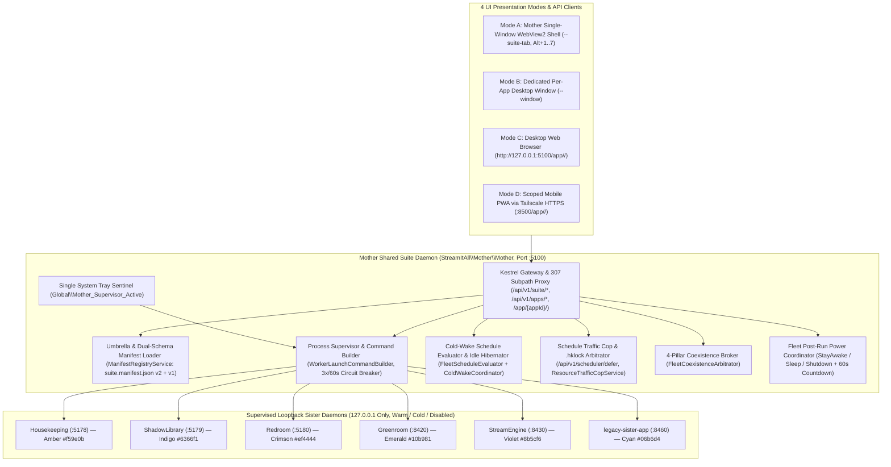
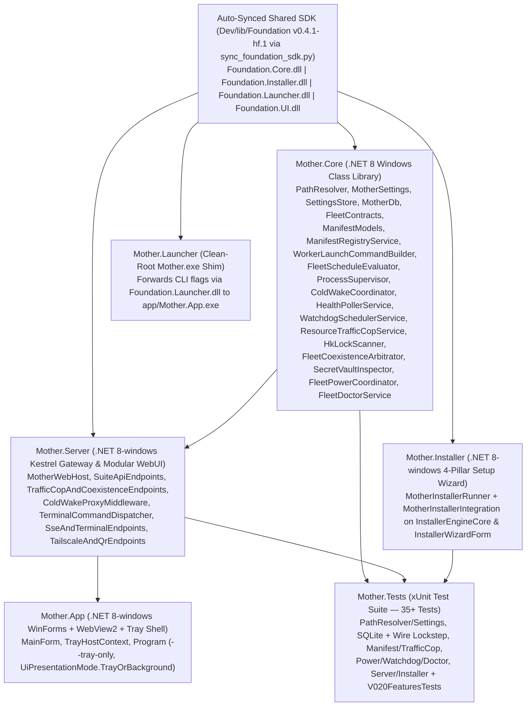

# Mother — Deep Architecture, Fleet Supervision Graph & Symbol Map (`ARCHITECTURE.md`)

> **Active Baseline Version:** `v0.2.0-hf.1` (`MPL-2.0`) | **Full SemVer (`MAJOR.MINOR.PATCH[-hf.N]`)** | **SDK Pin:** `Foundation v0.4.1-hf.1`

This technical manual documents the system context, runtime process topology, assembly dependency graph, end-to-end orchestration pipelines, file and symbol lookup registry, persistence stores, failure-mode engineering, security model, testing strategy, architectural decision records (ADRs), and zero-touch extension playbooks for **`Mother`** ([`<WORKSPACE_ROOT>/Mother\`](file:///<WORKSPACE_ROOT>/Mother/)), the Single Shared Suite Daemon (`:5100`), unified system tray sentinel, reverse-proxy API gateway, autonomous Cold-Wake scheduler, schedule traffic cop, post-run power coordinator, and cross-app coexistence broker for the 6 sister applications (**Housekeeping** `:5178`, **ShadowLibrary** `:5179`, **Redroom** `:5180`, **Greenroom** `:8420`, **StreamEngine** `:8430`, and **legacy-sister-app** `:8460`).

---

## 1. System Context & Runtime Model

> [!IMPORTANT]
> **Single Shared Suite Daemon & Single Public Gateway**
> `Mother` (`%LOCALAPPDATA%\Programs\StreamItAll\Mother\Mother\`) eliminates competing system tray icons, duplicate Task Scheduler watchdogs, and uncoordinated 3:00 AM disk thrashing across the workstation. Only `Mother` binds a public/LAN/Tailscale gateway port (`http://127.0.0.1:5100/`, Tailscale HTTPS `:8500`). All 6 sister applications run as supervised child workers bound strictly to `127.0.0.1` loopback (`:5178..5180`, `:8420..8460`) with `--managed-by-mother --bind 127.0.0.1 --port <effectivePort>`, managed according to their per-app residency mode (`Warm`, `Cold`, or `Disabled`).

### Runtime Process, Threading & Residency Model
1. **Single-Instance & Supervisor Mutexes:** On startup, `Mother` acquires `Global\Mother_SingleInstance_Mutex` and `Global\Mother_Supervisor_Active` (via `SupervisorIpc`, isolated with `Local\Mother.Isolated.<hash>` prefix when `IsIsolatedOverride` is active via `--data-dir` / `APP_ISOLATED_TEST=1`). Child sister apps inspect `Global\Mother_Supervisor_Active` (and `--managed-by-mother`) to suppress their standalone system tray icons.
2. **Sibling Containment (`AppEnvironment` / `PathResolver`):** Under isolated execution (`--data-dir` / `APP_ISOLATED_TEST=1`), `PathResolver.AssertContainedIfIsolated` / `ResolveIsolatedContainmentRoot` resolves and contains sibling test/worker roots inside the configured data/ancestor root without mutating host Registry, Task Scheduler, or `<PROGRAMS_ROOT>/` production trees.
3. **Per-App Residency Loop (`Warm`, `Cold`, `Disabled`):**
   - **`Warm` (`always-on`):** Spawned at `Mother` boot via `WorkerLaunchCommandBuilder` (`--managed-by-mother --bind 127.0.0.1 --port <effectivePort>`); health-polled every `250ms` during wake and `5000ms` steady-state (`HealthPollerService`).
   - **`Cold` (`on-demand`, `0 MB` idle RAM):** Not spawned at boot. Automatically woken on UI navigation (`/app/<app-id>/`), API call (`/api/v1/apps/<app-id>/*`), or due `schedules[]` entry (`FleetScheduleEvaluator` + `ColdWakeCoordinator`), and gracefully hibernated by `ColdWakeCoordinator.EvaluateIdleHibernationAsync` after `idleTimeoutMinutes` (`15m` default) once `activeJobs == 0` and `queuedJobs == 0`.
   - **`Disabled`:** Registered in `manifests\`, skipped by boot, schedules, and background polling until enabled.
4. **WebView2 Isolated Shell & Tab Strip (`Alt+1..7`):** `MainForm` hosts the Single-Window WebView2 shell (`DataDirectory\webview2` isolated user-data directory) across `Mother` and all discovered sister apps.

---

## 2. Project & Module Dependency Graph

`Mother` pins **`Foundation v0.4.1-hf.1`** (`Foundation.Core.dll`, `Foundation.Installer.dll`, `Foundation.Launcher.dll`, `Foundation.UI.dll`, plus `wwwroot\vendor\foundation\`) from [`<WORKSPACE_ROOT>/SharedLibs\Foundation\v0.4.1-hf.1\`](file:///<WORKSPACE_ROOT>/SharedLibs/Foundation/v0.4.1-hf.1/) into gitignored `Dev\lib\` (auto-synced pre-build by `Dev\deploy.ps1` via `sync_foundation_sdk.py --sync-consumer`):

| Project / Assembly | Target Framework | Allowed References | Forbidden References |
| :--- | :--- | :--- | :--- |
| **`Mother.Core`** | `net8.0-windows` | `Foundation.Core.dll`, BCL, `Microsoft.Data.Sqlite`, `System.Security.Cryptography.ProtectedData` | Zero WinForms/WebView2 UI dependencies; zero hardcoded host paths; zero direct sister-app repo references. |
| **`Mother.Server`** | `net8.0-windows` | `Mother.Core`, `Foundation.Core.dll`, `Microsoft.AspNetCore.App` | Zero direct mutations inside child sister-app `data\` databases (HTTP proxy + `.coexistence.json` only). |
| **`Mother.App`** | `net8.0-windows` | `Mother.Core`, `Mother.Server`, `Foundation.Core.dll`, `Microsoft.Web.WebView2` | Zero direct WinForms dependencies in `Mother.Core`. |
| **`Mother.Launcher`** | `net8.0-windows` | `Foundation.Launcher.dll` (embedded) | Zero heavy server/WinForms/SQLite libraries at clean root (`Mother.exe`). |
| **`Mother.Installer`** | `net8.0-windows` | `Foundation.Core.dll.gz`, `Foundation.Installer.dll.gz` (GZip-embedded via `AssemblyResolve`) | Zero Inno Setup, third-party MSI, or hardcoded PII/host paths (`FindingCount: 0`). |
| **`Mother.Tests`** | `net8.0-windows` | `Mother.Core`, `Mother.Server`, `Mother.Installer`, `Foundation.*`, `Microsoft.AspNetCore.TestHost`, `xUnit` | Zero uncontained `<PROGRAMS_ROOT>/...` or `%LOCALAPPDATA%\Programs\` mutations during test execution. |

---

## 3. End-to-End Data Flow per Pipeline

### Pipeline A: Umbrella Discovery, Command Building & Residency Supervision (`ManifestRegistryService` -> `WorkerLaunchCommandBuilder` -> `ProcessSupervisor`)
1. **Priority Scan Order (`PathResolver.ResolveProgramsRoot` & `ManifestRegistryService`):** In isolated mode (`--data-dir` / `APP_ISOLATED_TEST=1`), checks configured `--programs-dir`, `<DataDir>\manifests\`, and `<DataDir>\mock-apps\` without reading live host installs. In standard runs, inspects `MOTHER_HOME`, `HKCU\Software\StreamItAll\Mother\SuiteInstallDir|InstallDir`, umbrella parent `StreamItAll\Mother\`, `%LOCALAPPDATA%\Programs\StreamItAll\Mother\`, and read-only legacy `<PROGRAMS_ROOT>/` fallback.
2. **Dual-Schema Normalization & Aliases:** Normalizes both `v2` `camelCase` (`schemaVersion: 2`, `appId`, `schedules[]`, `commands.startDaemon`, `workerArgs`) and legacy `v1` `snake_case`, mapping residency aliases (`on-demand` -> `cold`, `always-on` -> `warm`) and nested/top-level `idleTimeoutMinutes`.
3. **Command Building & Launch (`WorkerLaunchCommandBuilder`):** Resolves `commands.startDaemon` primary or `executable` + `workerArgs`, validates contained `WorkingDirectory`, appends `--managed-by-mother --bind 127.0.0.1 --port <effectivePort>`, and injects `MANAGED_BY_SUITE=1`, `MOTHER_SUPERVISED=1`, and `MOTHER_GATEWAY_URL`.

### Pipeline B: Autonomous Cold-Wake `schedules[]` Loop & Idle Hibernation (`FleetScheduleEvaluator`)
1. Evaluates registered `schedules[]` (`cadence`, `timeUtc`, `runIfMissed`) every tick from `MotherRuntime.BackgroundLoopAsync` alongside `ColdWakeCoordinator.EvaluateIdleHibernationAsync`.
2. Checks `FleetCoexistenceArbitrator` + `.hklock` holds before triggering `triggerEndpoint` on a woken worker; records deferrals to SQLite `schedule_deferrals` and atomic `<dataDir>\scheduler-state.json`, or handles child/operator API calls on `GET`/`POST /api/v1/scheduler/defer`.

### Pipeline C: Fleet Schedule Traffic Cop & Coexistence Broker (`ResourceTrafficCopService`, `FleetCoexistenceArbitrator`)
1. `HkLockScanner` inspects `.<app>_<pid>.hklock` sentinels via `Foundation.Core.PidSafeLockfile.IsLockedByLiveProcess` across configured `MotherSettings.TargetDrives` and shared mounts, distinguishing `LIVE` vs. dead-PID `STALE` locks.
2. `FleetCoexistenceArbitrator` aggregates `/api/v1/coexistence/status` and offline `<SharedRoot>\.coexistence.json` manifests; **`Apply Safe-Stagger`** (`POST /api/v1/suite/coexistence/apply-recommendations`) aligns presets cleanly.

### Pipeline D: Fleet Post-Run Power Coordinator & Subpath Proxy (`FleetPowerCoordinator`, `ColdWakeProxyMiddleware`, `TerminalCommandDispatcher`)
1. `FleetPowerCoordinator` blocks OS sleep/shutdown via `PowerSleepInhibitor` (`SetThreadExecutionState`) until aggregate `activeJobs + queuedJobs == 0` and live `.hklock` count is `0`, then starts a 60-second cancellable countdown (simulated safely in isolated / `--dry-run` runs).
2. `ColdWakeProxyMiddleware` returns `307 Temporary Redirect` on `/app/{appId}` -> `/app/{appId}/` preserving query strings and injects `X-Forwarded-Prefix: /app/{appId}` upstream; `TerminalCommandDispatcher` executes `help`, `status`, `health`, `apps`, `traffic`, `locks`, `coexistence`, `doctor`, `logs [count]`, `purge-stale`, `reload`, `wake <appId>`, `stop <appId>`, and `power [StayAwake|Sleep|Shutdown]`.

---

## 4. Complete File & Symbol Lookup Registry (`<= 400 LOC` Hard Gate)

### 4.1 Dossiers, Blueprints & Reports

| File Path (Relative to `<WORKSPACE_ROOT>/Mother\`) | Role & Responsibility |
| :--- | :--- |
| [`active.state`](file:///<WORKSPACE_ROOT>/Mother/active.state) | Canonical Tier A lifecycle state marker (`v0.2.0-hf.1`, `productionSubpath: StreamItAll\Mother\Mother`). |
| [`README.md`](file:///<WORKSPACE_ROOT>/Mother/README.md) / [`FEATURES.md`](file:///<WORKSPACE_ROOT>/Mother/FEATURES.md) / [`ROADMAP.md`](file:///<WORKSPACE_ROOT>/Mother/ROADMAP.md) / [`CHANGELOG.md`](file:///<WORKSPACE_ROOT>/Mother/CHANGELOG.md) | Root Documentation Quartet + [`LICENSE`](file:///<WORKSPACE_ROOT>/Mother/LICENSE) (`MPL-2.0`) + [`AGENTS.md`](file:///<WORKSPACE_ROOT>/Mother/AGENTS.md). |
| [`Dev/docs/plans/v0.2.0.2026-11-15.md`](file:///<WORKSPACE_ROOT>/Mother/Dev/docs/plans/v0.2.0.2026-11-15.md) | Locked `v0.2.0` Blueprint reconciling predecessor audit findings and the working tasklist. |
| [`Dev/docs/reports/archive/`](file:///<WORKSPACE_ROOT>/Mother/Dev/docs/reports/archive/) | Archived diagnostic audits (`0448`, `0532`, `1715`, `0938`, `2115`). |

### 4.2 Implemented C# / PowerShell / Web Slices (`<= 400 LOC` Hard Gate)

| Slice Path (Relative to `Dev\`) | Code LOC Status | Primary Exported Symbols | Role & Responsibility |
| :--- | :---: | :--- | :--- |
| `migrations/0001_initial_schema.sql` | `64` (`PASS`) | `fleet_health_events`, `schedule_deferrals`, `notification_history` | Suite SQLite schema (`PRAGMA user_version = 1`). |
| `Mother.Core/Core/MotherRuntime.cs` | `185` (`PASS`) | `MotherRuntime` (`SdkVersion = "0.4.1-hf.1"`), `SuiteRuntimeOptions` | Central orchestrator wiring DB, supervisor, scheduler, traffic cop, power, and doctor. |
| `Mother.Core/Core/Configuration/{PathResolver,MotherSettings,SettingsStore}.cs` | `230` / `<=120` (`PASS`) | `PathResolver`, `MotherSettings` (`TargetDrives`), `SettingsStore` | Umbrella discovery (`StreamItAll\Mother`), contained `--data-dir` isolation, 20-snapshot ring buffer. |
| `Mother.Core/Core/Persistence/{MotherDb,MotherDbModels}.cs` | `329` / `152` (`PASS`) | `MotherDb`, `FleetHealthEventRow`, `ScheduleDeferralRow`, `NotificationHistoryRow` | `Foundation.Core.SqliteWalPool` (`WAL`, `busyTimeoutMs: 15000`, `PRAGMA user_version = 1`). |
| `Mother.Core/Core/{Diagnostics/MotherDiagnostics,Ipc/SupervisorIpc,Contracts/FleetContracts}.cs` | `128` / `133` / `205` (`PASS`) | `MotherDiagnostics`, `SupervisorIpc`, `SuiteHealthDto`, `SisterScheduleEntry`, `SisterCommandsEntry` | Zero-PII crash bundles, rolling JSONL logs, isolated mutexes, DTO wire contracts. |
| `Mother.Core/Features/Discovery/{ManifestModels,ManifestRegistryService}.cs` | `226` / `215` (`PASS`) | `ManifestRegistryService`, `ManifestParser`, `SisterAppEntry` | Dual-schema `v2`/`v1` loader, `schedules[]`, `commands`, residency aliases (`on-demand`/`always-on`). |
| `Mother.Core/Features/Supervision/WorkerLaunchCommandBuilder.cs` | `227` (`PASS`) | `WorkerLaunchCommandBuilder` | Resolves `workerArgs`/`commands.startDaemon`, contained `WorkingDirectory`, gateway env vars. |
| `Mother.Core/Features/Supervision/FleetScheduleEvaluator.cs` | `317` (`PASS`) | `FleetScheduleEvaluator`, `ScheduleRuntimeState` | Evaluates `schedules[]`, enforces coexistence deferrals, persists `scheduler-state.json`. |
| `Mother.Core/Features/Supervision/{ProcessSupervisor,ColdWakeCoordinator,HealthPollerService,WatchdogSchedulerService}.cs` | `319` / `<=115` (`PASS`) | `ProcessSupervisor`, `ColdWakeCoordinator` | `Warm`/`Cold`/`Disabled` lifecycle, idle hibernation, `250ms`/`5000ms` health poll, `3x/60s` breaker. |
| `Mother.Core/Features/TrafficCop/{HkLockScanner,ResourceTrafficCopService}.cs` | `158` / `137` (`PASS`) | `HkLockScanner`, `ResourceTrafficCopService` | PID-safe `.hklock` inspection, stale purge, schedule deferrals. |
| `Mother.Core/Features/Coexistence/{FleetCoexistenceArbitrator,SecretVaultInspector}.cs` | `219` / `84` (`PASS`) | `FleetCoexistenceArbitrator`, `SecretVaultInspector` | Conflict arbitration, `.coexistence.json` recommendations, key-metadata-only DPAPI inspection. |
| `Mother.Core/Features/{Power/FleetPowerCoordinator,Power/PowerSleepInhibitor,Doctor/FleetDoctorService,Notifications/NotificationDispatcher}.cs` | `<= 225` (`PASS`) | `FleetPowerCoordinator`, `FleetDoctorService`, `NotificationDispatcher` | `StayAwake`/`Sleep`/`Shutdown` 60s countdown, Doctor + SQLite backup/bundle, alerts. |
| `Mother.Server/{Program,MotherWebHost}.cs` & `Endpoints/*.cs` (6 files) | `153`–`248` (`PASS`) | `MotherWebHost`, `SuiteApiEndpoints`, `TrafficCopAndCoexistenceEndpoints`, `ColdWakeProxyMiddleware`, `TerminalCommandDispatcher`, `SseAndTerminalEndpoints`, `TailscaleAndQrEndpoints` | Kestrel gateway (`:5100`), `307 /app/{appId}` redirect, `X-Forwarded-Prefix`, `/api/v1/scheduler/defer`, expanded terminal commands, SSE, QR, PWA. |
| `Mother.Server/wwwroot/{index.html,css/*,js/*}` (10 custom files) | `44`–`342` (`PASS`) | `mother.css`, `mother-components.css`, `app.js`, `contracts.js`, `sortable-table.js`, `views/*` | Titanium Sky `#38bdf8` UI (`Alt+1..7`, `Ctrl+B`, `<= 820px` mobile nav, `Ctrl+\``, `Ctrl+K`/`?`). |
| `Mother.App/{Program,MainForm,TrayHostContext}.cs` & `Mother.Launcher/Program.cs` | `38`–`175` (`PASS`) | `MainForm`, `TrayHostContext`, `Mother.Launcher` | WinForms + WebView2 host, `--tray-only` (`UiPresentationMode.TrayOrBackground`), `TaskbarCreated`, clean-root shim. |
| `Mother.Installer/{Program,MotherInstallerRunner,MotherInstallerIntegration}.cs` | `117` / `<=340` / `<=125` (`PASS`) | `MotherInstallerRunner`, `MotherInstallerIntegration` | `Foundation.Installer.InstallerEngineCore` + `InstallerWizardForm`, `--profile`, `--suite-dir`, `--migrate-legacy`, decoupled HKCU/shortcuts, `--uninstall --dry-run` guard. |
| `deploy.ps1` & `package_installer.ps1` | `155` / `<=215` (`PASS`) | `deploy.ps1`, `package_installer.ps1` | Pre-build `sync_foundation_sdk.py --sync-consumer`, flat `Assets`/`migrations`, Clean Release Root (`LICENSE`, `app\LICENSE`, `settings.example.json`), 6-file `Releases\v0.2.0-hf.1\` + `Latest\`. |
| `Mother.Tests/*.cs` (7 files + `TempWorkspaceScope.cs`) | `<= 365` (`PASS`) | `V020FeaturesTests` + 6 suites | `35/35` xUnit tests passing under Release `/warnaserror`. |

---

## 5. Persistence Stores, SQLite Tables & Settings Ownership

| Store / File Path | Format & Encoding | Owning `Mother` Slice | Stored Fields & Responsibility |
| :--- | :--- | :--- | :--- |
| **`manifests\*.json`** | UTF-8 No-BOM `camelCase` (`schemaVersion: 2`) or `v1` | `ManifestRegistryService` | Dynamic registry of installed sister apps (`housekeeping`, `shadowlibrary`, `redroom`, `greenroom`, `streamengine`, `legacy-sister-app`). |
| **`data\settings.json`** | Atomic `.tmp` -> `.bak` JSON via `SettingsStore` | `Mother.Core.Configuration` | Stores `port`, `useGlobalFormatRules`, `postRunPowerPolicy`, `autoAlignSisterAppSchedules`, `targetDrives` (seeded from `Dev\config\settings.example.json`), and `residencyOverrides`. |
| **`data\scheduler-state.json`** | Atomic `.tmp` JSON via `FleetScheduleEvaluator` | `FleetScheduleEvaluator` | Tracks `scheduleId`, `lastRunAtUtc`, `nextRunAtUtc`, `deferMinutes`, and `deferReason`. |
| **`data\config_history\settings_*.json`** | 20-Snapshot JSON Ring Buffer | `SettingsStore` | Supports `Ctrl+S` 1-click config rollback across the 20 most recent suite configuration saves. |
| **`data\secrets.dpapi`** | Windows DPAPI (`CurrentUser`) via `DpapiSecretStore` | `SecretVaultInspector` | Encrypted `discord_webhook_url` and tokens; inspector reads key names & byte lengths only. |
| **`data\mother.db`** | SQLite `WAL` (`busyTimeoutMs=15000`, `PRAGMA user_version=1`) | `MotherDb` (`SqliteWalPool`) | Schema in `Dev\migrations\0001_initial_schema.sql`: `fleet_health_events`, `schedule_deferrals`, and `notification_history`. |
| **`<SharedRoot>\.coexistence.json`** | UTF-8 No-BOM `camelCase` JSON | `FleetCoexistenceArbitrator` | Shared-root coexistence status & active parity presets. |
| **`logs\mother_*.log` & `logs\crashes\crash_*.json`** | Rotating UTF-8 Logs + Zero-PII JSON Crash Bundles | `MotherDiagnostics` (`CrashBundleService`) | ISO-8601 structured daemon logs and sanitized 50-line ring-buffer crash bundles. |

---

## 6. Failure Modes, Security & Testing Strategy

| Failure Mode / Contention Scenario | Detection Mechanism | Automated Recovery / Control |
| :--- | :--- | :--- |
| **Child Sister Daemon Crashes or Hangs** | `HealthPollerService` polls `/api/v1/health`; monitors `Process.Exited`. | Restarts via `WorkerLaunchCommandBuilder`; trips `3x/60s` circuit breaker (`ERROR` state + alert). |
| **Two Apps Schedule Heavy Disk Jobs Simultaneously** | `ResourceTrafficCopService`, `HkLockScanner`, & `FleetScheduleEvaluator` check `.hklock` & `targetDrives`. | Defers conflicting run (`POST /api/v1/scheduler/defer` + `schedule_deferrals` + `scheduler-state.json`). |
| **Premature OS Sleep While a Sister App Works** | `FleetPowerCoordinator` checks aggregate `activeJobs + queuedJobs` and live `.hklock` holds. | Inhibits OS Sleep/Shutdown until fleet idle (`0`), then runs cancellable 60s countdown. |
| **Subpath Web UI Relative Asset Resolution** | Client requests `/app/<appId>` without trailing slash. | `ColdWakeProxyMiddleware` responds `307` -> `/app/{appId}/` and sets `X-Forwarded-Prefix: /app/{appId}`. |
| **Fresh Clone Missing Tracked `Dev\lib\` Binaries** | `Dev\deploy.ps1` checks for `Dev\lib\Foundation.Core.dll`. | Automatically invokes `sync_foundation_sdk.py --sync-consumer` against `Foundation v0.4.1-hf.1`. |

- **Security Model:** Loopback-only child workers (`127.0.0.1`), optional Tailscale CGNAT (`100.64.0.0/10`) filter, DPAPI encrypted secrets, isolated test guard (`APP_ISOLATED_TEST=1` / `AppEnvironment`), Clean-Room Git scrub (`Dev\lib\*.{dll,pdb,xml,deps.json}` gitignored), and signed zero-PII 4-pillar installer (`audit_installer.ps1` `FindingCount: 0`).
- **Verification Commands:**
  - `APP_ISOLATED_TEST=1 dotnet test "<WORKSPACE_ROOT>/Mother\Dev\Mother.slnx" -c Release -p:TreatWarningsAsErrors=true --logger "console;verbosity=normal"` (`35/35` passing, `0` warnings)
  - `powershell -ExecutionPolicy Bypass -File "%USERPROFILE%\.gemini\config\skills\dev\scripts\audit_installer.ps1" -InstallerPath "<WORKSPACE_ROOT>/Mother\Installers" -StagingDir "<WORKSPACE_ROOT>/Mother\Builds\v0.2.0-hf.1" -ExpectedVersion "0.2.0-hf.1"` (`FindingCount: 0`)

---

## 7. ADR Design Decisions Log & Zero-Touch Extension Playbook

| ADR ID | Version | Context & Problem | Decision Made |
| :--- | :---: | :--- | :--- |
| **`ADR-001`** | `v0.1.0` | All 6 sister apps use Left Vertical Navigation Rails. | Assign `Mother` the Top Horizontal Axis (`Alt+1..7`, `#38bdf8`) so inner and outer nav never collide. |
| **`ADR-002`** | `v0.1.0` | Per-app power/watchdog control risked sleeping PCs mid-job. | Centralize `FleetPowerCoordinator` & `\Mother_Watchdog` exclusively inside `Mother`. |
| **`ADR-003`** | `v0.1.0` | Legacy `v1` `snake_case` manifests coexist with `v2` `camelCase`. | Dual-schema loader in `ManifestRegistryService` + `.coexistence.json`. |
| **`ADR-004`** | `v0.1.0` | Sister apps check `minSuiteVersion` compatibility at a glance. | Strict 3-part SemVer (`MAJOR.MINOR.PATCH`). |
| **`ADR-005`** | `v0.2.0` | Flat `<PROGRAMS_ROOT>/` installs, tracked SDK DLLs, and stub schedulers blocked clean public distribution & autonomous Cold-Wake runs. | Adopt `%LOCALAPPDATA%\Programs\StreamItAll\Mother\Mother\` (`InstallerEngineCore`), gitignore `Dev\lib\` + auto-sync in `deploy.ps1`, extract `WorkerLaunchCommandBuilder` + `FleetScheduleEvaluator` + `TerminalCommandDispatcher`, and add `AppEnvironment` containment. |
| **`ADR-006`** | `v0.2.0-hf.1` | Legacy isolated staging directory, custom runner flags, and secondary port bifurcation leaked harness complexity into production binaries. | Remove legacy harness code and flags, align with `Foundation v0.4.1-hf.1` (`AppEnvironment`, `UiPresentationMode.TrayOrBackground`, `InstallerRuntimeContext`), and run all tests via `APP_ISOLATED_TEST=1`. |

**Zero-Touch Sister Onboarding:** Package `app\suite.manifest.json` (`schemaVersion: 2`, `sdkVersion: "0.4.1-hf.1"`, `commands.startDaemon`, `workerArgs`, `residency`, `endpoints`, and `schedules[]`), install via `Foundation.Installer.InstallerEngineCore` under `StreamItAll\Mother\<AppName>\`, and call `POST /api/v1/suite/apps/reload` (or run `reload` in `Mother`'s terminal).
