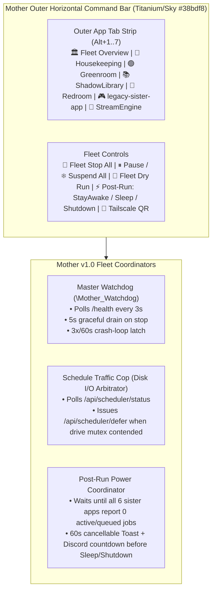

# Implementation Plan: Mother Unified Fleet Supervisor, Schedule Traffic Cop & Single-Window Ecosystem Shell (`v0.1.0`)

- **Plan ID / Filename:** `v0.1.0.2026-11-04.md`
- **Target Project:** `Mother` (`<WORKSPACE_ROOT>/Mother\`)
- **Target Build Version:** `v0.1.0` (Full SemVer `MAJOR.MINOR.PATCH` per Dev Bible Standard 03 §1; Sister-App Co-Packaging Gated for `v0.2.0` / `v1.0.0`)
- **Last Modified:** `2026-11-04`
- **Author:** `@pland` (Master Systems Architect)
- **Dev Bible Enforcer Sign-Off:** `@dean (PASS)`
- **Status:** `Design Locked — Awaiting Execution Directive`
- **Linked Diagnostic & Parity Reports (Auto-Archived on Ingestion):**
  - [`v0.1.0-alpha.1.2026-11-02_0448.-.scaffold-and-readiness-audit.md`](file:///<WORKSPACE_ROOT>/Mother/Dev/docs/reports/archive/v0.1.0-alpha.1.2026-11-02_0448.-.scaffold-and-readiness-audit.md)
  - [`v0.1.0-alpha.1.2026-11-02_0532.-.sister-app-feature-parity.md`](file:///<WORKSPACE_ROOT>/Mother/Dev/docs/reports/archive/v0.1.0-alpha.1.2026-11-02_0532.-.sister-app-feature-parity.md)
  - [`v0.1.0-alpha.1.2026-11-03_1715.-.fleet-coexistence-broker-and-manifest-schema.md`](file:///<WORKSPACE_ROOT>/Mother/Dev/docs/reports/archive/v0.1.0-alpha.1.2026-11-03_1715.-.fleet-coexistence-broker-and-manifest-schema.md) (`Status: Planned in v1.0.0-rc.1` — Dual `camelCase`/`snake_case` `mother.manifest.json` loader, `FleetCoexistenceArbitrator` polling `/api/v1/coexistence/status`, 1-click Fleet `Auto-Align`, and `.hklock`-aware Traffic Cop)

---

## 1. Context, Goal & `/grill-me` Fleet Architecture Decisions

- **Objective:** Build **Mother (`v1.0.0-rc.1`)**, the ultra-lightweight desktop supervisor, fleet traffic cop, and single-window container application that discovers and orchestrates all installed local sister applications (**Housekeeping** `:5178`, **ShadowLibrary** `:5179`, **Redroom** `:5180`, **Greenroom** `:8420`, **StreamEngine** `:8430`, **legacy-sister-app** `:8460`) via `mother.manifest.json`.
- **Key Architectural Updates from `@inspecter` Reports (`0448` & `0532`) and `/grill-me` Fleet Lock-In:**
  1. **Standalone `v1.0` Rollout First, `v1.1` Co-Packaging Gate (`0532` Pillar 1):** Build, verify, and ship **`Mother v1.0.0-rc.1`** as a standalone application first. Co-installing `Mother` inside the 6 sister-app installers is gated for **`v1.1.0`** once `Mother v1.0` is live.
  2. **Fleet-Wide Post-Run Power Coordinator (`StayAwake / Sleep / Shutdown` Moved to `Mother v1.0`, `0532` Pillar 4):** Individual sister apps no longer expose standalone Sleep/Shutdown triggers (which risked putting the PC to sleep while another sister app was mid-operation). Mother owns the global **Post-Run Power Action (`StayAwake / Sleep / Shutdown`)** selector in its outer top bar, monitoring all registered sister apps and only triggering OS Sleep/Shutdown after **every** active and queued job across the entire fleet reaches `Idle` (with a 60-second cancellable countdown toast and Discord notification).
  3. **Centralized Master Watchdog (`\Mother_Watchdog` Moved to `Mother v1.0`, `0532` Pillar 5):** Individual sister apps are retiring their per-app Windows Task Scheduler watchdogs. Mother owns the single **`\Mother_Watchdog`** Task Scheduler entry and continuously supervises, health-polls, and restarts all registered child sister daemons launched with `--managed-by-mother`.
  4. **Fleet Schedule Traffic Cop / Disk I/O Mutex Arbitrator (`0532` Pillar 6):** Mother polls child `/api/scheduler/status` endpoints and issues `/api/scheduler/defer` locks so two disk-intensive sister apps (e.g., `Housekeeping` + `ShadowLibrary` or `Redroom`) never thrash the same physical drive simultaneously at 3:00 AM.
  5. **Orthogonal Navigation Harmony (`0532` Pillar 7):** Because all 6 sister apps standardize on **Greenroom's Left Sidebar Rail (`220px`/`56px`) + Slim Top Action Bar (`48px`)**, Mother owns the **Top Horizontal Axis** (`Alt+1..6` outer app tab strip + `🏛️ Fleet Overview` tab + Titanium/Sky `#38bdf8` accent + Global Post-Run Power selector + `🛑 Fleet Stop All` + `⏸ Fleet Pause / ❄ Suspend All` + `🧪 Fleet Dry Run`) with zero "double horizontal tab bar" visual collision.
  6. **C# WinForms Single-Surface Dark GUI Installer (`ShadowLibrary rc.10-hf.2` Standard) & Clean Release Root (`0448` F-01..F-06, `0532` Pillars 2 & 3):** Replace Inno Setup with the canonical **C# WinForms Single-Surface Dark GUI Setup & Uninstall Wizard** (`Mother.Installer` with `InstallerWizardForm.cs`, `650×434` -> `650×544`) deploying a **Clean Release Root** (`Mother.exe` launcher shim at root, runtime assemblies & `version.txt` inside `app\`, non-pausing `.bat` scripts in `scripts\`, interactive scripts in `scripts\interactive\`), plus Standard 15 `CrashBundleWriter.cs` (`logs\crashes\crash_*.json`, `10 MB × 5` log rotation) and root `active.state` synchronization.

---

## 2. Dev Bible & Architectural Invariants Check

- [x] **5-Folder Layout & Root `active.state` (`0448` F-01):** All code confined to `<WORKSPACE_ROOT>/Mother\Dev\`; root `<WORKSPACE_ROOT>/Mother\active.state` synced with `version: "1.0.0-rc.1"`.
- [x] **Clean Release Root & `scripts\` Parity (`0448` F-04, F-05):** Only `Mother.exe` launcher shim sits at `Builds\v1.0.0-rc.1\` and `<PROGRAMS_ROOT>/Mother\` root; all DLLs, WebView2 runtimes, and `app\version.txt` reside inside `app\`; non-pausing scripts in `scripts\`; pausing scripts in `scripts\interactive\`.
- [x] **Sandboxing & Deterministic `--test-mode --headless` Exit (`0448` F-05):** Exposes `--programs-dir`, `--data-dir`, `--config`, `--log-dir`, `--port`, `--test-mode`, `--dry-run`, and `--headless`. Running `--test-mode --headless` executes a deterministic startup self-test (mutex check, `--programs-dir` manifest discovery, mock health poll, traffic-cop arbitration check, and clean exit `0`).
- [x] **Single-EXE Authenticode Dark GUI Installer (`0448` F-03, `0532` Pillar 2):** C# WinForms `InstallerWizardForm.cs` (`650×434` -> `650×544`), Authenticode-signed, zero `.pdb`/PII leaks, retained in `Installers\` and mirrored to `<WORKSPACE_ROOT>/Installers\`.
- [x] **Standard 15 Crash Dumper & `10 MB × 5` Log Rotation (`0448` F-05):** `StructuredLogger.cs` (`YYYY-MM-DDTHH:mm:ss.fffZ [v1.0.0-rc.1] [PID:X/T:Y] [LEVEL] [slice] message`, `10 MB × 5` rotation, 30-day pruning) and `CrashBundleWriter.cs` (50-line ring buffer -> `<log_dir>\crashes\crash_YYYYMMDD_HHMMSS_v1.0.0-rc.1.json`, max 20 retained).

---

## 3. Architecture & Technical Design

### 3.1 Standardized `mother.manifest.json` Contract
```json
{
  "$schema": "https://schemas.local/mother.manifest.v1.json",
  "id": "housekeeping",
  "name": "Housekeeping",
  "brandAccent": "#f59e0b",
  "version": "1.0.0-rc.11",
  "executable": "Housekeeping.exe",
  "args": ["--minimized", "--managed-by-mother"],
  "port": 5178,
  "healthEndpoint": "http://127.0.0.1:5178/api/health",
  "schedulerStatusEndpoint": "http://127.0.0.1:5178/api/scheduler/status",
  "schedulerDeferEndpoint": "http://127.0.0.1:5178/api/scheduler/defer",
  "stopAllEndpoint": "http://127.0.0.1:5178/api/jobs/stop-all",
  "uiUrl": "http://127.0.0.1:5178/",
  "targetDrives": ["C:", "D:", "E:", "X:"],
  "autoStart": true
}
```

### 3.2 Fleet Orchestration & Supervision Topology


---

## 4. Phased Task Roadmap (for `@devv`)

### Phase 1: Solution Scaffolding, Manifest Discovery, IPC & Structured Logging (`0448` F-01, F-02, F-05)
- [ ] **Task 1.1: Solution & Project Scaffolding (`Mother.slnx`) + Root `active.state`**
  - **Targets:**
    - `<WORKSPACE_ROOT>/Mother\active.state` — Update `"version": "1.0.0-rc.1"`, `"last_version_at": "2026-11-02"`.
    - `<WORKSPACE_ROOT>/Mother\Dev\Directory.Build.props` & `Dev\version.txt` (`1.0.0-rc.1`).
    - `<WORKSPACE_ROOT>/Mother\Dev\Mother.slnx` containing:
      - `Mother.Core` (Class Library, .NET 8/9)
      - `Mother.Server` / `Mother.App` (Kestrel Fleet Portal + WebView2/WinForms Desktop & Tray Host, `win-x64`)
      - `Mother.Launcher` (Lightweight root `Mother.exe` shim forwarding CLI args to `app\Mother.App.exe`)
      - `Mother.Installer` (C# WinForms Single-Surface Dark GUI Setup & Uninstall Wizard, `InstallerWizardForm.cs`)
      - `Mother.Tests` (xUnit test suite)
- [ ] **Task 1.2: Standard 15 `StructuredLogger.cs` & `CrashBundleWriter.cs`**
  - **Target:** `Mother.Core\Diagnostics\StructuredLogger.cs` & `Mother.Core\Diagnostics\CrashBundleWriter.cs`
  - **Action:** Format log lines as `YYYY-MM-DDTHH:mm:ss.fffZ [v1.0.0-rc.1] [PID:X/T:Y] [LEVEL] [slice] message`, rotate logs at `10 MB × 5` (with 30-day age pruning), maintain a 50-line in-memory ring buffer, and register `AppDomain.CurrentDomain.UnhandledException`, `TaskScheduler.UnobservedTaskException`, and `Application.ThreadException` to write sanitized Zero-PII `crash_YYYYMMDD_HHMMSS_v1.0.0-rc.1.json` bundles (max 20 retained) to `<log_dir>\crashes\`.
- [ ] **Task 1.3: Manifest Discovery & Single-Instance / Supervisor Mutexes**
  - **Target:** `Mother.Core\Discovery\AppDiscoveryService.cs` & `Mother.Core\IPC\SupervisorIpc.cs`
  - **Action:** Scan `--programs-dir` (`<PROGRAMS_ROOT>/` by default, `Sandbox\data\mock_programs\` in sandbox) for `*/mother.manifest.json` or `*/app/mother.manifest.json`. Acquire `Global\Mother_SingleInstance_Mutex` and `Global\Mother_Supervisor_Active`.

### Phase 2: Master Watchdog, Schedule Traffic Cop & Post-Run Power Coordinator (`0532` Pillars 4, 5, 6, 8, 10)
- [ ] **Task 2.1: Process Supervisor & Master Watchdog (`\Mother_Watchdog`)**
  - **Target:** `Mother.Core\Supervisor\ProcessSupervisor.cs` & `Mother.Core\Supervisor\WatchdogSchedulerService.cs`
  - **Action:** Launch supervised child apps with `--managed-by-mother`, poll `healthEndpoint` (250ms during startup to prevent `ERR_CONNECTION_REFUSED`, 3000ms steady-state), enforce 5-second graceful shutdown drain before termination, latch after 3 crashes in 60s, and manage the single `\Mother_Watchdog` Windows Task Scheduler entry.
- [ ] **Task 2.2: Fleet Schedule Traffic Cop (Drive I/O Mutex Arbitrator)**
  - **Target:** `Mother.Core\Orchestration\FleetScheduleTrafficCop.cs`
  - **Action:** Poll `/api/v1/scheduler/status` (with `/api/scheduler/status` fallback) across active sister apps and inspect active `<Root>\.<app>_<pid>.hklock` sentinels on `managedRoots`. When two sister apps target the same physical drive (`targetDrives`), issue `POST /api/v1/scheduler/defer` to stagger the secondary scheduled job until the primary drive-intensive job or `.hklock` mutation finishes.
- [ ] **Task 2.4: Dual-Schema Manifest Tolerance & Fleet Coexistence Broker (`FleetCoexistenceArbitrator.cs`, Report `1715`)**
  - **Target:** `Mother.Core\Discovery\AppDiscoveryService.cs` & `Mother.Core\Orchestration\FleetCoexistenceArbitrator.cs` (`<350 LOC`)
  - **Action:**
    1. Upgrade `AppDiscoveryService.cs` to accept both Standard 17 §5.1 `camelCase` (`schemaVersion: 1`, `id`, `name`, `brandAccent`, `healthEndpoint`, `coexistenceStatusEndpoint`) and legacy `snake_case` (`schema_version`, `app_id`, `display_name`, `brand_accent`/`brand_color`, nested `endpoints.*`) so Mother discovers all 6 sister apps regardless of upgrade order.
    2. Implement `FleetCoexistenceArbitrator.cs` to poll `GET /api/v1/coexistence/status` across all 6 sister apps (`:5178`, `:5179`, `:5180`, `:8420`, `:8430`, `:8460`) and read offline `<Root>\.coexistence.json` manifests, exposing `GET /api/v1/coexistence/status` (fleet aggregate) and `POST /api/v1/coexistence/apply-recommendations` (dispatching 1-click preset alignment to child apps), plus a **Fleet Coexistence & Shared Storage Matrix** panel in `🏛️ Fleet Overview` and `🩺 Fleet System Doctor` with an opt-in **`Auto-Align Shared Settings Across Fleet`** toggle (`default: false`).
- [ ] **Task 2.3: Fleet Post-Run Power Coordinator (`StayAwake / Sleep / Shutdown`) & Notification Engine**
  - **Target:** `Mother.Core\Orchestration\FleetPowerCoordinator.cs` & `Mother.Core\Notifications\FleetNotificationService.cs`
  - **Action:** Monitor aggregate active/queued jobs across all discovered sister apps. When `PostRunPowerAction` is `Sleep` or `Shutdown` and all apps transition from busy to `0` active/queued jobs, start a 60-second cancellable countdown with Windows Tray Toast + Discord Webhook notification before invoking OS Sleep/Shutdown (no-op in `--test-mode` / `--dry-run`).

### Phase 3: Outer Horizontal App Tab Shell, `🏛️ Fleet Overview` Left Sidebar & WebView2 Virtualization (`0532` Pillars 7, 9, 11, 12)
- [ ] **Task 3.1: Outer Horizontal App Tab Strip (`Alt+1..7`) + Virtualized WebView2 Host**
  - **Target:** `Mother.App` & `Mother.Server` (`wwwroot/index.html`, `app.js`, `styles.css`)
  - **Action:** Render the outer horizontal app tab strip (`🏛️ Fleet Overview` + discovered sister apps with live status dots, Titanium/Sky `#38bdf8` accent, `🛑 Fleet Stop All`, `⏸ Fleet Pause / ❄ Suspend All`, `🧪 Fleet Dry Run`, `⚡ Post-Run: StayAwake / Sleep / Shutdown`, and `📱 Tailscale QR`). Suspend inactive tabs via `TrySuspendAsync()` to keep Mother's base footprint `< 35 MB`.
- [ ] **Task 3.2: `🏛️ Fleet Overview` Dashboard, `Ctrl+\`` Multi-App Log Drawer, `Ctrl+K`, `Ctrl+S` & `🩺 Fleet System Doctor`**
  - **Action:** Inside `🏛️ Fleet Overview`, provide the standard collapsible Left Sidebar Rail (`Overview`, `Fleet Schedules & Traffic Cop`, `Unified Logs`, `Notifications`, `Config Snapshots`, `🩺 Fleet System Doctor`) with all-drives Free-Space footer, `Ctrl+\`` aggregated multi-app log drawer, `Ctrl+K` cross-app Omni-Search, `Ctrl+S` 20-snapshot config rollback, `?` Hotkey Modal, sortable/exportable (`📥 Export CSV/JSON`) fleet tables, and `🩺 Fleet System Doctor` (`Backup All DBs (.7z)` & `Export Fleet Diagnostic Bundle`).

### Phase 4: Clean Release Root, Prebuilt `scripts\` & C# WinForms Dark GUI Installer (`0448` F-03, F-04, F-06; `0532` Pillars 1, 2, 3)
- [ ] **Task 4.1: Prebuilt `Dev\scripts\` & `Dev\scripts\interactive\` Suite**
  - **Target:** Create non-pausing `Dev\scripts\` (`build.bat`, `run.bat`, `test.bat`, `package_installer.bat`, `start-daemon.bat`, `stop-daemon.bat`, `status-check.bat`, `backup-now.bat`) and pausing counterparts in `Dev\scripts\interactive\`.
- [ ] **Task 4.2: C# WinForms Single-Surface Dark GUI Installer (`Mother.Installer`)**
  - **Target:** `Dev\Mother.Installer\Mother.Installer.csproj`, `Program.cs`, `InstallerWizardForm.cs`, `InstallerEngine.cs`
  - **Action:** Port `ShadowLibrary.Installer`'s `650×434` -> `650×544` dark WinForms wizard (`#38bdf8` Sky accent), packaging `Mother.exe` launcher shim at root, runtime assemblies & `version.txt` inside `app\`, and scripts in `scripts\` / `scripts\interactive\`. Sign `Mother-Setup-v1.0.0-rc.1-win-x64.exe`, retain in `<WORKSPACE_ROOT>/Mother\Installers\`, mirror to `<WORKSPACE_ROOT>/Installers\`, and create `Archive\Mother-release-v1.0.0-rc.1-*.7z`.
- [ ] **Task 4.3: Complete `Dev\README.md` & `Dev\CHANGELOG.md`**
  - **Target:** Expand [`Dev\README.md`](file:///<WORKSPACE_ROOT>/Mother/Dev/README.md) with full architecture, CLI flags, and manifest specification, and consolidate [`Dev\CHANGELOG.md`](file:///<WORKSPACE_ROOT>/Mother/Dev/CHANGELOG.md) under `## [1.0.0-rc.1] - 2026-11-02`.

---

## 5. Sandbox Verification & Test Strategy (for `@inspecter`)

- **Isolated Sandbox Target:** `<WORKSPACE_ROOT>/Mother\Sandbox\`
- **Verification Commands:**
  ```powershell
  # 1. xUnit Test Suite (Manifest Discovery, Traffic Cop Arbitration, Power Coordinator, Crash Dumper)
  dotnet test "<WORKSPACE_ROOT>/Mother\Dev\Mother.slnx" -c Release

  # 2. Headless Self-Test in Sandbox (Must exit 0 deterministically)
  <WORKSPACE_ROOT>/Mother\Sandbox\Mother.exe --test-mode --headless --programs-dir "<WORKSPACE_ROOT>/Mother\Sandbox\data\mock_programs" --data-dir "<WORKSPACE_ROOT>/Mother\Sandbox\data" --config "<WORKSPACE_ROOT>/Mother\Sandbox\data\config.json" --log-dir "<WORKSPACE_ROOT>/Mother\Sandbox\logs" --port 15100

  # 3. 4-Pillar Installer Audit
  powershell -ExecutionPolicy Bypass -File "%USERPROFILE%\.gemini\config\skills\dev\scripts\audit_installer.ps1" -InstallerPath "<WORKSPACE_ROOT>/Mother\Installers" -ExpectedVersion "1.0.0-rc.1"
  ```
- **Verification Checklist:**
  1. Confirm `Mother-Setup-v1.0.0-rc.1-win-x64.exe` passes `audit_installer.ps1` (`FindingCount: 0`), is mirrored to `<WORKSPACE_ROOT>/Installers\`, and extracts a Clean Release Root (`Mother.exe` at root, runtime in `app\`, scripts in `scripts\` and `scripts\interactive\`).
  2. Confirm Mother discovers mock sister apps in `Sandbox\data\mock_programs`, arbitrates concurrent drive schedules via `/api/scheduler/defer`, coordinates post-run power countdowns safely in `--test-mode`, and writes structured ISO-8601 logs and crash bundles inside `Sandbox\logs\`.

---

## 6. Execution Recommendation

| Task Characteristics | Recommended Model | Thinking Level | Rationale |
| :--- | :--- | :--- | :--- |
| **Greenfield Multi-Process Supervisor, Disk Mutex Arbitrator & WinForms GUI Installer** | **Gemini 3.1 Pro** or **Gemini 3.8 Flash** | **High** | High reasoning depth ensures clean process supervision lifecycles, deadlock-free schedule arbitration, and 4-pillar installer compliance. |
