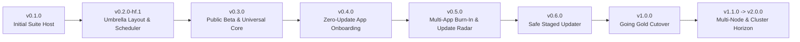

# Mother — Strategic Roadmap & Milestones

Current baseline: **v0.3.0 (Public Beta)** | Active target: **v0.4.0 (Zero-Update App Onboarding)** | Goal: **v1.0.0** | See [CHANGELOG.md](CHANGELOG.md) for release notes.

---

## 1. North Star Goal

Deliver a universal, pluggable shared suite daemon (`:5100`), unified system tray sentinel, reverse-proxy API gateway, autonomous Cold-Wake scheduler, disk I/O traffic cop, coexistence broker, post-run power coordinator, and safe staged suite/app updater so any manifest-compliant application can integrate cleanly with `Mother` without modifying `Mother` itself—culminating in an authorized `v1.0.0` production cutover at `%LOCALAPPDATA%\Programs\StreamItAll\Mother\Mother\`.

---

## 2. Active Next Milestone: v0.4.0 — Zero-Update App Onboarding & Pluggable Suite UX

Allow operators and third-party developers to register, validate, inspect, and unregister any compliant application dynamically at runtime without modifying `Mother`.

- [ ] **Dynamic Registration API & CLI:** Add CLI `--register-app`, `--unregister-app`, and `--validate-manifest`, plus REST `POST /api/v1/suite/apps/register` and `DELETE /api/v1/suite/apps/{appId}` storing managed entries in `data/manifests/<appId>.json` using canonical target path keys (`targetInstallDir`/`productionSubpath`) rather than legacy aliases.
- [ ] **Security & Process Containment Guards:** Add `ManifestValidator` (strict `appId` slug regex, `installDir` path containment, shell/UNC/traversal/`internalPort == motherPort`/command-metacharacter rejection), `LoopbackCsrfGuardMiddleware` (`Host`/`Origin` enforcement on mutating `/api/v1/*` routes), and graceful child process shutdown on unregister/reload so zero orphan workers remain.
- [ ] **Dynamic Pluggable UI & Onboarding Guide:** Build the `+ Register App` drawer, dynamic `Alt+1..9` tab switching enhancements, validated `?tab=` routing, custom icon/accent rendering, and `Dev/docs/INTERFACES.ThirdPartyApps.md` using neutral examples (`demo-worker`, `media-tool`).
- [ ] **Verification Gate:** Security negative unit tests (traversal, shell injection, CSRF origin rejection, orphan cleanup) and Stage 2 4-Drive Sandbox E2E registering two custom sandbox apps, rejecting a malformed manifest cleanly, and persisting registration across restarts with inspected screenshots.

---

## 3. Upcoming Milestones

### v0.5.0 — Live Multi-App Fleet Burn-In & Read-Only Update Radar
- **Cornerstone Theme:** Prove multi-app coexistence under realistic multi-worker load while giving users passive visibility into available releases.
- **Planned Deliverables & Verification Criteria:**
  - [ ] **Shared Updater Schema Gate:** Complete formal schema dictionary registration prior to planning for updater keys (`releaseRepo`, `updateFeedUrl`, `updateChannel`, `latestVersion`, `releaseUrl`, `isUpdateAvailable`, `lastUpdateCheckAtUtc`, `stagedUpdateVersion`, `updateStatus`).
  - [ ] **Runtime Hardening & Multi-App Sandbox Burn-In:** Scan drive-root `.hklock` files across configured `TargetDrives`, add single-flight `SemaphoreSlim` Cold-Wake locking, lift the 30-second proxy HTTP timeout on SSE streams while bounding request body buffering, retry failed scheduled wakes instead of advancing `NextRunAtUtc`, drain `StopAllAsync` workers in parallel, and execute partial-suite (`0..N`) co-bootstrapping burn-in across optional StreamItAll suite members (`Housekeeping`, `ShadowLibrary`, `Redroom`, `Greenroom`, `StreamEngine`) inside the 4-Drive Sandbox.
  - [ ] **Non-Blocking Update Radar & Tailscale HTTPS Guidance:** Add background/manual GitHub Release checking per registered repository (`ETag`/`304`, `>= 6h` persisted cache, `403` rate-limit backoff, optional DPAPI token) plus `tailscale serve` HTTPS pairing guidance for mobile PWA installs.
  - [ ] **Verification Gate:** Mocked GitHub API tests (`304`, `403`, offline fallback), concurrent wake stampede tests, long-lived SSE stream tests, and Stage 2 Sandbox E2E across multiple concurrent workers and removable drives with clean logs and inspected screenshots.

### v0.6.0 — Safe Staged Suite & App Updater
- **Cornerstone Theme:** Deliver opt-in, cryptographically verified, lock-aware staged upgrades and automatic rollback recovery for `Mother` and registered apps.
- **Planned Deliverables & Verification Criteria:**
  - [ ] **Hardened Resumable Downloader:** Wrap `Foundation.Core.SafeNetworkTransfer` with `SafeGithubHttpHandler` enforcing TLS 1.2+, HTTPS-only URLs, GitHub domain/SSRF allowlists, required `User-Agent`, Zip-Slip path sanitization, `.partial_<jobId>` resumable transfers, pre-flight free-space checks (`1.1x + 512 MB`), and progress heartbeats.
  - [ ] **Cryptographic Verification & Pre-Upgrade Snapshots:** Require strict `SHA256SUMS.txt` digest match and Authenticode signature validation before staging; capture `VACUUM INTO` + `PRAGMA integrity_check` DB backups, `data/config/settings.json`, `data/manifests/`, and previous app payloads into `data/rollback/v<prev>/`; track history in `0002_update_history.sql`.
  - [ ] **Quiesce Gate, Detached Self-Update & Auto-Rollback:** Enforce `.mother_update_<pid>.hklock` and zero active jobs/locks before upgrading; add a graceful `shutdown` IPC command; launch Mother self-upgrades detached outside the parent Job Object (`--silent --install-dir <dir> --wait-pid <pid> --launch`) while upgrading sister apps via `--silent --install-dir <dir> --no-launch`; harden `WaitForTargetUnlocked` to fail closed on locked binaries; verify post-upgrade `/api/v1/suite/health` and auto-restore `v<prev>` on failure.
  - [ ] **Verification Gate:** Stage 1 tamper/SSRF/lock-deferral/rollback unit tests plus Two-Build Stage 2 Sandbox E2E proving lock-deferred upgrade waits cleanly, good upgrade preserves `mother.db` and settings, and simulated unhealthy post-upgrade boot triggers automatic rollback.

### v1.0.0 — Going Gold & Canonical Production Cutover
- **Cornerstone Theme:** Lock stable `v1.0.0` contracts, validate multi-day stability, and perform authorized production cutover.
- **Planned Deliverables & Verification Criteria:**
  - [ ] **Contract Freeze & Soak Certification:** Freeze `v1.0.0` `suite.manifest.json` (`v2`) and `/api/v1/suite/*` APIs with backward compatibility for `0.x` apps; verify multi-day `v0.5.0`/`v0.6.0` burn-in soak logs (`0` crashes, stable handles and memory) and full installer/static/legacy-precedence checks (`0` critical/high/medium findings).
  - [ ] **Authorized Production Cutover & GA Release:** With explicit operator approval, take a pre-cutover `.7z` backup, execute opt-in `--migrate-legacy` cutover into `%LOCALAPPDATA%\Programs\StreamItAll\Mother\Mother\`, verify live health across installed sister apps, and publish non-prerelease `v1.0.0` GA across GitHub Releases, Google Drive, and Discord.

### v1.1.0 -> v2.0.0 — Multi-Node & Distributed Horizon
- **`v1.1.0` — Multi-Node Telemetry Aggregation:** Collect read-only health, drive capacity, and schedule status across multiple LAN/Tailscale workstations into a unified fleet timeline.
- **`v2.0.0` — Distributed Job Routing & Cluster Arbitration:** Coordinate cross-workstation Cold-Wake routing and shared NAS storage locks across peer `Mother` nodes.

---

## 4. Completed Milestones

- [x] **v0.3.0 (2026-11-19):** Upgraded to `Foundation v0.5.1` (including zero-dependency ISO/IEC 18004 QR code SVG generation), removed all hardcoded legacy sister-app defaults for a clean 0-app empty state and Doctor `"pass"`, guarded `port <= 0` (`503 NO_HTTP_ENDPOINT`), inverted manifest discovery precedence, upgraded `.coexistence.json` to `schemaVersion: 2`, migrated settings non-destructively to `data/config/settings.json` (`schemaVersion: 2`), shipped self-contained `win-x64` `Mother.App` + NativeAOT/trimmed `Mother.exe` launcher + WebView2 runtime fallback, closed Stage 2 4-drive sandbox containment (`ExitCode = 3`) and Debug-only UI automation (`ExitCode = 2` fail-closed in Release), adopted declarative `installer.manifest.json` v2 + `StandardInstallerHost` + 7-file `Releases\v0.3.0\` (`Portable.zip` + hardlinked `Latest\`, retiring the legacy standalone installer folder), added root `SECURITY.md` & `CONTRIBUTING.md`, scrubbed technical manuals, and passed `40/40` isolated xUnit tests + Two-Build Stage 2 Sandbox E2E verification (pending final history scrub and human-gated public Beta launch). ([Notes](CHANGELOG.md#030---2026-11-19))
- [x] **v0.2.0-hf.1 (2026-11-15):** Updated to `Foundation v0.4.1-hf.1`, standardized isolated test execution (`APP_ISOLATED_TEST=1`) and `UiPresentationMode.TrayOrBackground`, and retired legacy external test harnesses (`35/35` passing tests). ([Notes](CHANGELOG.md#020-hf1---2026-11-15))
- [x] **v0.2.0 (2026-11-15):** Adopted the `StreamItAll\Mother\Mother\` install layout, sibling discovery, `WorkerLaunchCommandBuilder`, `FleetScheduleEvaluator` (`schedules[]` + `/api/v1/scheduler/defer`), idle hibernation, `307 /app/{appId}` subpath proxy, expanded terminal diagnostics, and initial Git scrub. ([Notes](CHANGELOG.md#020---2026-11-15))
- [x] **v0.1.0 (2026-11-12):** Shipped initial Shared Suite Daemon (`:5100`), Kestrel gateway, `.hklock` Traffic Cop, Coexistence Broker, Post-Run Power Coordinator, Titanium Sky WebView2 + PWA UI, clean-root launcher, and single-EXE installer. ([Notes](CHANGELOG.md#010---2026-11-12))

---

## 5. Icebox

Ideas and explicit non-goals intentionally parked outside `v1.0.0` scope:

- **Forced Silent Auto-Updates:** Background updates that restart active services or overwrite binaries without explicit user opt-in and active-lock verification.
- **Hosting Standalone Non-Suite Apps:** Supervising standalone desktop tools or hardware utilities that do not run as suite daemons; optional cross-app handoffs stay loosely coupled via CLI/files.
- **Centralized App Marketplace / Storefront:** Hosting third-party binary catalogs inside `Mother` (dynamic registration reads user-supplied manifests and approved repository releases directly).
- **Non-Windows Daemon Hosts:** Native Linux or macOS supervisor ports remain out of scope until post-`1.0` milestones stabilize Windows desktop operations.
